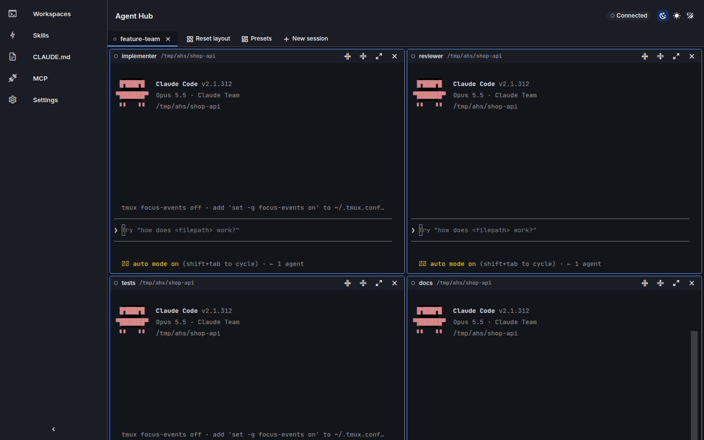

# Agent Hub

[](https://github.com/<owner>/<repo>/actions/workflows/ci.yml)


Agent Hub is a local web app for running and organizing Claude Code sessions. It runs inside WSL and shows the sessions as terminal tabs with split panes in the browser.



## Features

- Terminal tabs with split panes, backed by tmux sessions that survive a server restart
- Saved workspace presets (YAML) with layouts and optional autostart
- Session state (working, waiting, idle, error) from Claude Code hooks
- Skills and CLAUDE.md editor for global, project and git-worktree scopes
- MCP server configuration
- Experimental agent-team views (off by default)

## Experimental: agent teams

Agent teams build on an experimental Claude Code feature (Claude Code 2.1.309 or later) and are off by default. Set `experimental.agentTeams: true` in `~/.config/agent-hub/config.yaml` (or through `PATCH /api/config`) to get the Teams view: a read-only task board per team and team templates (`~/.config/agent-hub/teams/<name>.yaml`, see [examples/teams](examples/teams)). Launching a template starts the lead session; Claude Code spawns the teammates from the generated first prompt, so names and models are requests, not guarantees. Upstream changes can break this at any time; see [ADR 0010](docs/adr/0010-agent-teams.md) and [ADR 0012](docs/adr/0012-team-templates.md). Reference: [team templates and agent teams](docs/configuration.md#agent-teams-experimental).

## Quick start

Inside WSL2 with systemd, Node.js 22 or later and tmux 3.2 or later (on x64 the release ships a prebuilt node-pty, so no compiler is needed):

```bash
curl -fsSL https://github.com/Dev-Sebi/Paneful-Manager/releases/latest/download/install.sh | sh
```

The repository is private for now, so the anonymous URL answers 404. Get `install.sh` with the GitHub CLI and pass a token (a fine-grained token with read-only Contents access, or none when `gh` is logged in):

```bash
gh release download --repo Dev-Sebi/Paneful-Manager --pattern install.sh
GITHUB_TOKEN=<token> sh install.sh
```

Or download the release with `gh release download --repo Dev-Sebi/Paneful-Manager --pattern 'agent-hub-*.tar.gz*'` and run `sh install.sh --from-source agent-hub-<tag>.tar.gz`. Details: [Private repository](docs/install.md#private-repository).

The installer shows a plan and asks before it changes anything. It sets up the systemd user services `agent-hub-tmux.service` and `agent-hub.service`. Then open the login URL it prints in your browser (in WSL: your Windows browser). Each login URL works once, within 10 minutes; `install.sh --login-url` prints a new one, for example for another browser.

Flags, the list of changes, upgrade, rollback and uninstall are in the [install guide](docs/install.md).

## Documentation

- [Install guide](docs/install.md): requirements, installer flags, what changes on the system, upgrade and uninstall
- [Configuration](docs/configuration.md): `config.yaml` keys, environment variables, file locations, preset reference
- [Troubleshooting](docs/troubleshooting.md): symptoms, causes and fixes
- [Architecture](docs/architecture.md): components, process model, security model, session states
- [Documentation index](docs/README.md): all documents, including the decision records and the design system
- [Contributing](CONTRIBUTING.md)

## Development

```bash
git clone <repo-url> agent-hub
cd agent-hub
pnpm install
pnpm dev
```

Open the URL from `pnpm login-url --port 3000` in your browser (Vite dev server; a one-time login code, see [Login URL](docs/install.md#login-url)), later `http://127.0.0.1:3000` is enough. The API server listens on the configured port (default `7337`); the Vite proxy forwards to `AGENT_HUB_PORT` or `7337`, so set `AGENT_HUB_PORT` when `config.yaml` uses another port.

## Requirements

- WSL2 with systemd enabled (or plain Linux with systemd)
- Node.js 22 or later
- pnpm 11 or later
- tmux 3.2 or later
- git
- Claude Code CLI

## Configuration

- App config: `~/.config/agent-hub/config.yaml`
- Workspace presets: `~/.config/agent-hub/workspaces/*.yaml`
- Server port: `port` in `config.yaml` (default `7337`); the environment variable `AGENT_HUB_PORT` overrides it

Example files are in `examples/`. All keys are listed in the [configuration reference](docs/configuration.md).

## License

MIT. See [LICENSE](LICENSE).
