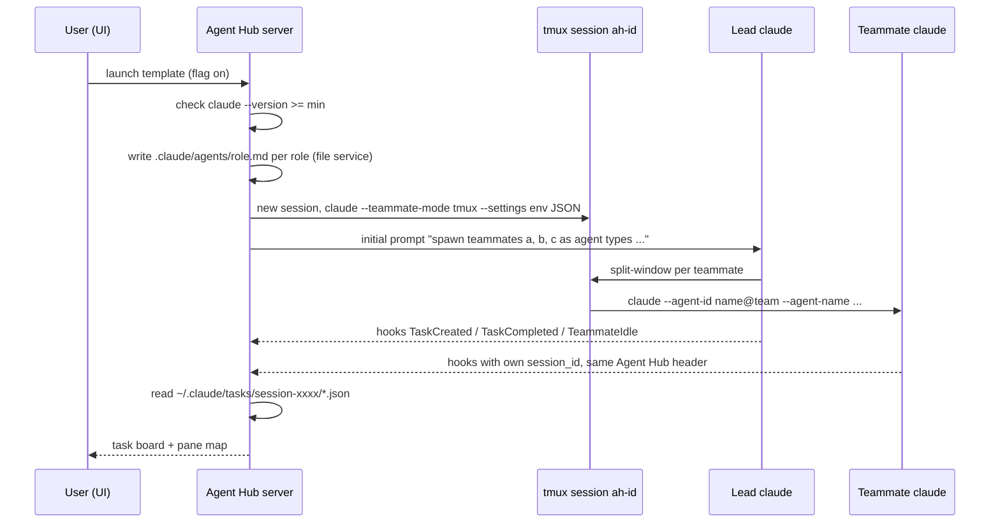

# ADR 0010: Agent teams (experimental)

- Status: proposed
- Date: 2026-10-27

## Context

Agent Hub wants to support Claude Code agent teams:

- (a) launch a team from a YAML template (roles, prompts, model per role),
- (b) show a read-only live task board from the team's task files,
- (c) map teammates to terminal panes.

The feature is experimental upstream. This spike records what is stable enough to build on and what is guessed. Sources: the official docs (agent teams, hooks, tools reference), the upstream changelog, and the local install (`claude --version` 2.1.311, `claude --help`, string search in the shipped binary; names only, no code copied, no session contents read).

Marks: **docs** = verified in the official docs, **changelog** = verified in the upstream changelog, **local** = verified in the local install, **assumed** = not verified.

## Findings

| Topic | Finding | Source |
| --- | --- | --- |
| Enablement | Env var `CLAUDE_CODE_EXPERIMENTAL_AGENT_TEAMS=1` (shell or `env` in `settings.json`); off by default. `0` turns it off, higher-precedence settings and managed settings can turn it back on | docs |
| Interactive only | With `-p` (and Agent SDK) no teammates are spawned | docs |
| Introduced | 2.1.32 ("research preview", needs the env var); `TeammateIdle` and `TaskCompleted` hooks in 2.1.33; `TaskCreated` hook in 2.1.84 | changelog |
| Team creation | No `TeamCreate`/`TeamDelete` tools any more (removed in 2.1.178). Every session with the flag has one implicit team; the lead spawns a teammate by calling the `Agent` tool with a `name`. No CLI flag creates a team (inference: none documented or in `--help`); the user asks in natural language | docs, changelog |
| Team name | `session-` + first 8 characters of the lead's session id (the lead's only) | docs |
| Task list id | Env `CLAUDE_CODE_TASK_LIST_ID` exists in the binary; it appears to redirect the task directory | local (name), assumed (meaning) |
| Roles | Teammates can use subagent definitions from project, user, managed or plugin scope (e.g. `.claude/agents/<role>.md`). Applied: `tools`, `model`; body appended to the system prompt in-process, replaces it in split-pane; `skills` never applied; `disallowedTools`, `effort`, `autoCompactWindow` in-process only; `mcpServers` split-pane only. Project agent files are re-applied to a respawned teammate only if their folder is trusted | docs |
| `--agents` flag | Exists (`--agents <json-or-file>`); the file form works only with `--print`. Not passed to split-pane teammates, so it is no role source for them | local (flag), assumed (teammate behavior) |
| Model per teammate | Order: model named in the spawn prompt, definition `model`, `CLAUDE_CODE_SUBAGENT_MODEL`, lead model; checked against `availableModels`. A mod's `agent.spawn` hook can replace the first source; `CLAUDE_CODE_SUBAGENT_MODEL_FORCE=1` skips the first two (2.1.257+) | docs |
| Display modes | `teammateMode` setting or `--teammate-mode <mode>` flag: `in-process` (default), `auto`, `tmux`, `iterm2`. `auto` uses split panes when already inside tmux or in iTerm2 with the `it2` CLI, else in-process. The flag is hidden from `--help` | docs, local |
| tmux backend | Teammate panes are tracked by tmux pane id; a tmux session named `claude-swarm` exists for the case "lead not inside tmux". A `claude-swarm-<pid>` name exists too (likely a socket name) | local (strings) |
| Inside-tmux layout | When the lead runs inside tmux, teammates split the lead's current window (`split-window` string present, target window not verified) | assumed |
| Separate processes | Split-pane teammates are separate `claude` processes; in-process teammates are not | docs |
| Teammate argv | `--agent-id`, `--agent-name`, `--team-name`, `--agent-color`, `--parent-session-id`, optional `--plan-mode-required`, `--agent-type`; env includes `CLAUDECODE=1`, `CLAUDE_CODE_EXPERIMENTAL_AGENT_TEAMS=1` | local (strings) |
| Command override | Env `CLAUDE_CODE_TEAMMATE_COMMAND` exists; meaning (override of the teammate launch command) | assumed |
| Teammate address | `name@team`, carried in `teammate_id`; `agent_id` is a separate agent id | changelog (2.1.290) |
| Team config | `~/.claude/teams/<team>/config.json`, removed at session end, rewritten on every state change, must not be edited | docs |
| Team config keys | Top level: `name`, `createdAt`, `leadAgentId`, `leadSessionId`, `leadProcess`, `members[]`. Member: `agentId`, `name`, `agentType`, `color`, `planModeRequired`, `joinedAt`, `tmuxPaneId`, `cwd`, `subscriptions`, `backendType` (`in-process`/`tmux`). Lead member: `agentType: "team-lead"` | docs (`members`, `team-lead`), local (other keys) |
| Mailbox | `~/.claude/teams/<team>/inboxes/<agent>.json`; invalid entries are removed on read | docs |
| Task list | Directory `~/.claude/tasks/<team>/`, kept after session end until `cleanupPeriodDays` | docs |
| Task files | One JSON file per task named `<id>.json`, plus a `.highwatermark` file; claiming uses file locks | `.highwatermark` local, locks docs, file naming assumed |
| Task shape | `id`, `subject`, `description`, `status`, `blocks[]`, `blockedBy[]`, optional `activeForm`, `owner`, `metadata` | local (schema strings) |
| Task states | `pending`, `in_progress`, `completed`; "blocked" is derived from unfinished `blockedBy` | docs, local |
| Task tools | `TaskCreate`, `TaskGet`, `TaskList`, `TaskUpdate` are on by default only for Opus 4.7, Sonnet 4.6, Haiku 4.5 and older. Newer models need `CLAUDE_CODE_ENABLE_TODO_TOOLS=1` (or naming a tool in `--allowedTools`/`--tools`); without them no task list is written | docs |
| Hooks | `TeammateIdle` (`teammate_name`, `team_name`), `TaskCreated` and `TaskCompleted` (`task_id`, `task_subject`, optional `task_description`, `teammate_name`, `team_name`). No matchers. `team_name` is deprecated. `agent_id` on these events needs 2.1.290 | docs |
| Permissions | Teammates start in the lead's mode (not `dontAsk`); no per-teammate mode at spawn; prompts surface in the lead. Split-pane teammates inherit `--tools` and deny rules from 2.1.309, never `--allowedTools` | docs, changelog |
| Limits | No hard teammate limit (3-5 recommended); one team per session; no nested teams; lead fixed; in-process teammates not restored by `/resume`; task status can lag; shutdown can be slow | docs |
| Stability | Docs label the feature experimental with known limitations; changelog shows frequent breaking changes (tool removal in 2.1.178, `agent_id` semantics in 2.1.290) | docs, changelog |

## Launch flow



## Decision

- Feature flag `experimental.agentTeams` in `config.yaml`, default `false`. With it off, nothing in this ADR runs.
- **Supported versions:** 2.1.309 is the lowest tested version, not a proven boundary. Reasons: implicit team since 2.1.178, `agent_id` in team hooks since 2.1.290, split-pane `--tools`/deny inheritance since 2.1.309; nothing below was run. `claude --version` is compared as full semver (patch releases have broken behavior before). Below 2.1.309 or unparsable: launch is refused with "Agent teams need Claude Code 2.1.309 or later (found `<version>`). Update Claude Code or turn off experimental.agentTeams." Above 2.1.311 (last tested): launch is allowed with an "untested version" badge.
- **T51 (template + launch) may rely on:** `--teammate-mode tmux`; a generated first prompt that names each teammate and its agent type; env passed as `claude --settings '{"env":{"CLAUDE_CODE_EXPERIMENTAL_AGENT_TEAMS":"1","CLAUDE_CODE_ENABLE_TODO_TOOLS":"1","CLAUDE_CODE_TASK_LIST_ID":"<per-launch id>"}}'` so it reaches split-pane teammates (plain process env does not reliably). Roles are written as `.claude/agents/<role>.md` (prompt = body, `model`, `tools`) into the project through the file service (allowlisted path, backup before overwrite, removed when the team ends). The project folder must be trusted, otherwise respawned teammates lose the definition. Roles from agent files must be verified in a real run before T51 relies on them; `--agents` is not used. T51 must not write `~/.claude/teams/` and must not rely on a team-creation API.
- **T52 (task board) may rely on:** `~/.claude/tasks/<dir>/`, where `<dir>` is the `CLAUDE_CODE_TASK_LIST_ID` set by T51, else the team name derived from the lead's Claude session id; the three statuses; `blockedBy`. It reads only, with the tolerant parser below, and uses `TaskCreated`/`TaskCompleted` hooks (via ADR 0007 handlers) only as a "re-read now" trigger plus a slow poll.
- **T53 (pane mapping) may rely on:** split-pane teammates being separate processes in tmux panes. Mapping uses `members[].tmuxPaneId` and `name` from `config.json`, cross-checked with `tmux list-panes -F '#{pane_id} #{pane_pid}'`; members with `backendType: "in-process"` get no pane and show as "in lead".
- **Teammate hooks (T26 handler, used by T52/T53):** split-pane teammates inherit the `AGENT_HUB_*` env and fire hooks with their own `session_id`. The handler attributes events to the lead's Agent Hub session by `X-Agent-Hub-Session-Id`. Only events whose payload `session_id` equals the lead's known Claude session id drive the session status (ADR 0007); others are routed into a per-teammate status map keyed by `teammate_name` or `agent_id` (T53), or ignored when neither is present.

## Tolerant parser contract (T52)

- Input: every `*.json` in the task directory; dot files (e.g. `.highwatermark`) and lock files are skipped.
- Unknown fields are ignored (zod `.passthrough()` or `.strip()`, never `.strict()`).
- Required: `id` (string), `subject` (string), `status` (string). A file missing one, or with invalid JSON, is skipped and logged once per file; it never fails the board.
- Filename and `id` disagree: trust `id`, log a warning.
- `status` outside `pending | in_progress | completed` maps to `unknown` and is shown as such.
- Optional with defaults: `description` `""`, `owner` none, `activeForm` none, `blocks` `[]`, `blockedBy` `[]` (non-string entries dropped in both), `metadata` ignored by the UI.
- Derived: `blocked = status === "pending" && blockedBy has an id whose task is not completed`.
- Partial writes: a file that fails to parse is retried on the next read; the last good version stays shown.

```json
{
  "id": "3",
  "subject": "Write integration tests for the parser",
  "description": "Cover missing fields and unknown status values",
  "activeForm": "Writing integration tests",
  "owner": "tester",
  "status": "in_progress",
  "blocks": ["5"],
  "blockedBy": ["1"],
  "metadata": {}
}
```

## Risks and re-verification at implementation time

- Everything marked **local** or **assumed** comes from string search, not from a running team. T51 must run one real team (tmux mode, inside an `ah-` session) and confirm: the task file naming, the config keys, the inside-tmux split behavior, and the teammate argv.
- The team config is removed at session end, so pane mapping only works while the lead runs; the task directory survives.
- `team_name` in hooks is deprecated; prefer deriving the name from the lead's `session_id` and fall back to `team_name`. Teammate hook payloads carry the teammate's `session_id`, never use it to derive the team name.
- `CLAUDE_CODE_TASK_LIST_ID` redirects the task directory (assumed). An inherited value from the user's environment would point the board at the wrong list, so T51 always sets it explicitly per launch (or unsets it); verify the redirect in a real run.
- Split-pane teammates firing Agent Hub hooks: without the `session_id` filter, a teammate going idle would flip the lead's status. Verify the inherited headers and payloads in a real run.
- Teammate panes created by Claude Code split the lead's tmux window (assumed); Agent Hub's own pane layout and resize rule (one size per tmux session) may conflict. Verify before T53.
- Model-dependent task tools: if `CLAUDE_CODE_ENABLE_TODO_TOOLS` changes name or default, the board stays empty; show "no task list found" instead of an error.
- Hidden `--teammate-mode` flag may change without notice; fall back to `teammateMode` in a `--settings` JSON payload.
- Permission prompts of all teammates surface in the lead pane; the UI must make that pane obvious.
- Re-run this check list on every Claude Code minor bump above the tested version.

## Consequences

- Team support is opt-in and read-only towards Claude Code state; Agent Hub never writes team or task files.
- A Claude Code upgrade can break the board or the pane map silently; the version gate and the tolerant parser limit the blast radius.

## Alternatives considered

- **Drive via tmux only, no on-disk parsing:** launch the lead and read panes. Simple and robust against file format changes, but no task board, and pane-to-teammate mapping would rely on parsing terminal output (rejected in ADR 0007 for the same reason).
- **Wait for a stable API:** no work now and no breakage risk, but no team support for an unknown time. Rejected because the flag keeps the cost of breakage low.
- **Pre-author team config:** not supported upstream; the file is overwritten at runtime.
