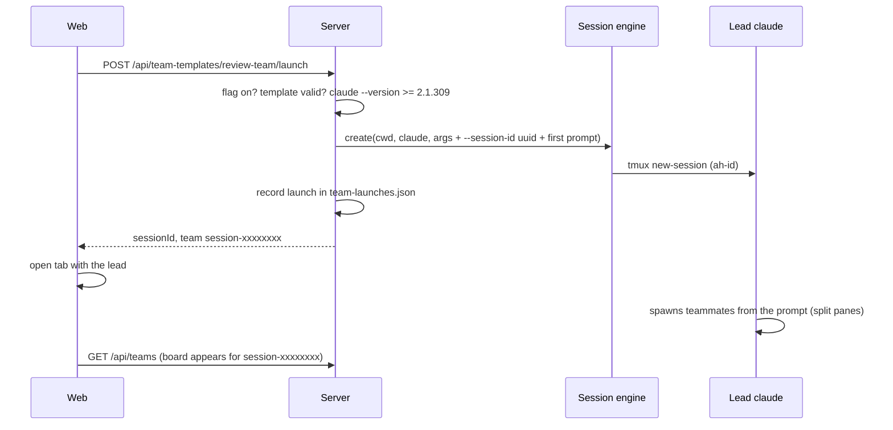

# ADR 0012: Team templates and launch (experimental)

- Status: proposed
- Date: 2026-10-27

## Context

[ADR 0010](0010-agent-teams.md) allows T51 to launch an agent team from a YAML template. Claude Code has no API or CLI flag that creates a team or pre-defines teammates: the lead spawns teammates itself (via the `Agent` tool) when asked in natural language. Agent Hub can only start the lead with the right flags and a first prompt. The lead's team name (`session-<first 8 characters of the lead's Claude session id>`) is needed to link the launch to the task board.

## Decision

- Templates are `~/.config/agent-hub/teams/<name>.yaml` (`TeamTemplateSchema` in `packages/shared/src/team-templates.ts`), example in `examples/teams/`. The store reuses the preset rules through a shared named-YAML store (`apps/server/src/files/yaml-store.ts`): name regex and length cap, realpath confinement, atomic `0600` writes, backups, `404`/`409`.
- Shape: `name`, `description?`, `experimental: true` (required marker), `goal?`, `lead { cwd, command (claude), args ([]), model? }`, `teammates[1-8] { name, prompt, cwd?, model? }`, `env {}`.
- `env` only accepts an allowlist of keys (`TEAM_TEMPLATE_ENV_KEYS`: model, token and timeout tuning, telemetry switches). Keys that change process loading, paths or Agent Hub internals are refused at the schema, so a template cannot inject code into the lead.
- `lead.args` must not contain flags the launch sets or that stop teammates (`--teammate-mode`, `--session-id`, `--settings`, `--model`, `-p`/`--print`, `--resume`, `--continue`, `--fork-session`).
- Launch (`POST /api/team-templates/:name/launch`):
  1. `<lead command> --version` (via `run()`, no shell) must report `>= 2.1.309`, else `409` with the ADR 0010 message. Above 2.1.311 the response sets `untestedVersion` and the UI shows a warning.
  2. The server picks the lead's Claude session id (`--session-id <uuid>`), so the team name is known before Claude Code starts.
  3. One session is created through the session engine: `<template args> --teammate-mode tmux --session-id <uuid> --settings '{"env":{...template env, CLAUDE_CODE_EXPERIMENTAL_AGENT_TEAMS:"1", CLAUDE_CODE_ENABLE_TODO_TOOLS:"1", CLAUDE_CODE_TASK_LIST_ID:"<team>"}}' [--model <m>] <first prompt>`. Template args come first, so the launch's flags end any option list before the prompt. The task list id equals the team name, so the board finds the tasks whether or not the redirect works.
  4. The first prompt is generated (`buildLeadPrompt`): every teammate with its name, instructions, optional model and working directory, plus the goal.
  5. The launch (`template`, `sessionId`, `team`, `launchedAt`) is appended to `$STATE/team-launches.json` (pattern of ADR 0011, separate file); entries whose lead session is gone are dropped on the next write. A ledger write failure is logged and does not undo the launch.
  6. If anything after the lead start fails, the lead session is killed; a failed lead start records nothing.
- No `.claude/agents/<role>.md` files are written. ADR 0010 requires a real run before relying on agent files, and they would add writes into the user's project. Teammate roles travel in the first prompt only.
- With `experimental.agentTeams` off, every `/api/team-templates` route answers `404` (checked per request, follows a live config change) and the web shows no template UI.
- Web: a "Templates" section in the Teams view (list, create/edit dialog, delete confirm, launch). Launch opens a tab with the lead session; each live launch shows its team name and a "View board" link once the team's board appears.

## Limits

- Teammates are spawned by Claude Code, not by Agent Hub. Names, models and working directories in the prompt are requests; the lead may deviate, and a model is still checked against `availableModels`.
- Claude Code spawns teammates in the lead's directory; a teammate `cwd` is only an instruction.
- No per-teammate tools or permission mode (ADR 0010: teammates start in the lead's mode).
- Not verified in a real team run yet: the first-prompt spawn behavior, `--session-id` with agent teams, and the task list redirect (ADR 0010 risks).

## Consequences

- One click starts a configured team; the board link works without hooks because the team name is fixed up front.
- Template files are user data like presets: loose objects, unknown keys kept, comments survive updates.
- The generic YAML store removes the duplicate CRUD code from the preset store.

## Alternatives considered

- **Agent files per role:** stronger role definitions (tools, model), but unverified for split-pane teammates, needs a trusted folder, and writes into the project. Can be added later behind the same flag.
- **`--agents` JSON:** not passed to split-pane teammates (ADR 0010).
- **Learning the team name from hooks:** needs installed hooks and a running lead; `--session-id` makes it deterministic.
- **Plain process env instead of `--settings`:** does not reliably reach split-pane teammates (ADR 0010).
