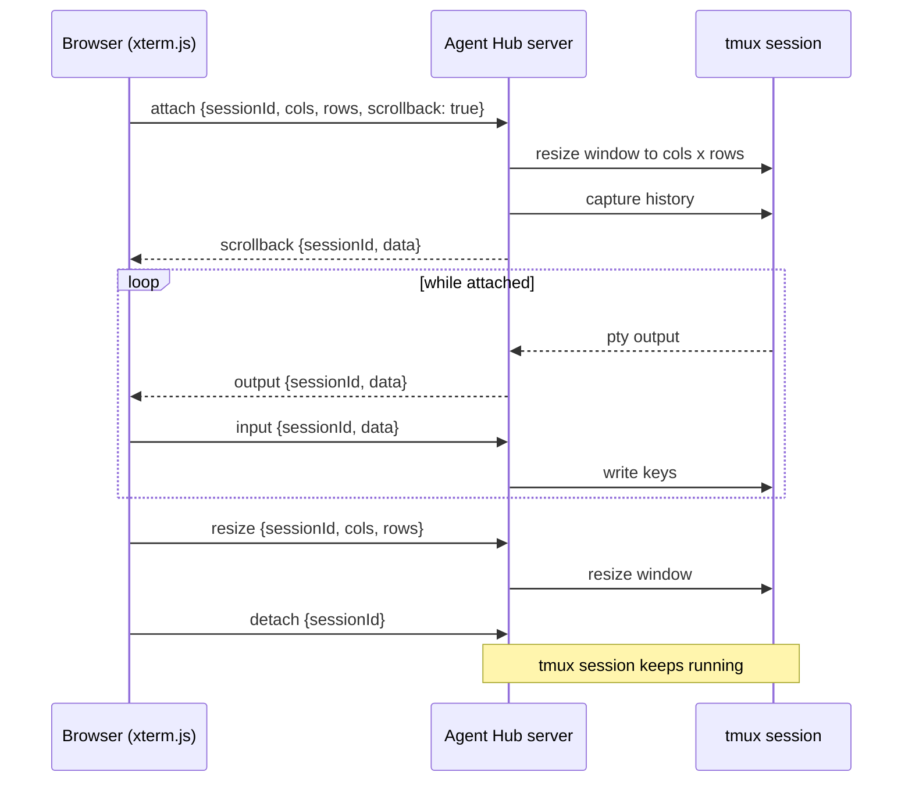

# Agent Hub architecture

Agent Hub is a local web app running inside WSL that manages Claude Code sessions. Each session runs in its own tmux session; the browser shows them as terminal panes arranged in tabs.

## Overview

To be written in T03.

## Server

To be written in T03.

## Web client

To be written in T03.

## Shared contracts

All contracts live in `packages/shared` (`@agent-hub/shared`) as zod schemas. Every schema is exported as `XSchema` with its inferred type `X` (and `XInput` where defaults make input and output differ). Server and web client import the same schemas, so validation and types never drift.

### Strict vs. passthrough

| Where data comes from | Unknown keys | Why |
| --- | --- | --- |
| REST bodies, WS frames, sessions, runtime tabs | rejected (`z.strictObject`) | Typos and protocol drift fail loudly at the boundary. |
| User files: `config.yaml`, preset YAML, MCP entries, layouts | kept (`z.looseObject`) | Users may add keys from newer versions or their own notes; a load/save cycle must not lose them. |

The REST wrappers around presets (`{ preset }`) are strict, but the preset itself stays loose, so `GET` then `PUT` keeps user-added keys. `ConfigPatchSchema` is strict because it is an API body, not a file.

### Product defaults (`defaults.ts`)

| Constant | Value |
| --- | --- |
| `DEFAULT_PORT` | `7337` (env `AGENT_HUB_PORT` overrides: digits only, 1-65535, otherwise startup fails; see `resolvePort`) |
| `BIND_HOST` | `127.0.0.1` (never configurable) |
| `DEFAULT_HOST_ID` | `local` (single user in v1, field kept for multi-user later) |
| `DEFAULT_COMMAND` | `claude` |
| `DEFAULT_COLS` / `DEFAULT_ROWS` | `120` / `30` |
| `MAX_TERMINAL_SIZE` | `1000` cols/rows |
| `MAX_PANES_PER_TAB` | `6` |
| `CONFIG_FILE` | `~/.config/agent-hub/config.yaml` |
| `WORKSPACES_DIR` | `~/.config/agent-hub/workspaces/*.yaml` |
| `resolveConfigDir(env)` | `$XDG_CONFIG_HOME/agent-hub` when set, otherwise `~/.config/agent-hub`; the constants above are the fallback |
| `DEFAULT_CONFIG` | equals `AppConfigSchema.parse({})` |
| `EXAMPLE_PRESET` | preset `project1`: 4 panes side by side in `~/git/project1` |

Paths may start with `~`; the server expands them.

### Schemas

| Module | Schema | Purpose |
| --- | --- | --- |
| `scope.ts` | `PathSchema` | Non-empty path, `~` allowed. |
| | `ScopeKindSchema`, `ScopeSchema` | `{ kind: global \| project \| worktree, path, branch?, projectPath? }`; `branch`/`projectPath` only for worktrees. |
| `config.ts` | `AppConfigSchema` | `config.yaml`: `port`, `experimental.agentTeams` (false), `confirmCloseTab` (true), `projects` (paths), `logLevel` (`info`), `theme` (`dark` \| `light` \| `system`, default `dark`). |
| | `ConfigPatchSchema` | Partial update; nested objects merge, arrays replace (`applyConfigPatch`). |
| | `PortSchema`, `LogLevelSchema`, `ThemeSchema` | Building blocks; `resolvePort(configPort, env)` applies `AGENT_HUB_PORT`, `resolveConfigDir(env)` applies `XDG_CONFIG_HOME`. |
| `session.ts` | `SessionSchema` | One session = one tmux session: `id`, `hostId`, `title?`, `cwd`, `command`, `args`, `tmuxSession`, `createdAt`, `state`, `lifecycle`, `exitCode?` (only when exited), `lastEventAt`, `cols`, `rows`. Timestamps are ISO 8601 strings. |
| | `SessionStateSchema` | `working \| waiting \| error \| idle`, derived from Claude Code hooks. |
| | `SessionLifecycleSchema` | `starting \| running \| exited`. |
| `layout.ts` | `LayoutSchema` | `single \| row \| column \| grid-2x2 \| custom`; `custom` carries a split tree (`LayoutNodeSchema`) whose leaves point at pane indexes and carry relative `size` weights. |
| | `AppTabSchema`, `AppPaneSchema` | Runtime tab with 1-6 panes, each a `sessionId` plus optional `size`. |
| | `validateLayoutPanes` | `single` = 1 pane, `grid-2x2` = 4, `custom` must reference each pane exactly once. |
| `preset.ts` | `WorkspacePresetSchema` | Preset file: `name` (also the file name), `description?`, `autostart` (false), `tabs[]`. |
| | `PresetTabSchema`, `PresetPaneSchema` | Tab: `title?`, `layout` (default `row`; string shorthand `single \| row \| column \| grid-2x2` or the object form, `custom` needs the object), 1-6 panes. Pane: `cwd`, `command` (`claude`), `args` (`[]`), `title?`, `size?`. |
| `mcp.ts` | `McpServerSchema` | Discriminated by `transport`: `stdio` (`command`, `args`, `env?`) or `http`/`sse` (`url`, `headers?`); `scope` is `global \| project \| worktree`. |
| `api.ts` | `ApiErrorSchema` | Every non-2xx body: `{ code, message, details? }`; `validation_failed` requires `details: { path, message }[]` (`toValidationError`). |
| | REST schemas | See table below. |
| `ws.ts` | `ClientMessageSchema`, `ServerMessageSchema` | WebSocket protocol, see below. |

Minimal preset (`~/.config/agent-hub/workspaces/project1.yaml`; full examples in `examples/`, validated by `examples.test.ts`):

```yaml
name: project1
tabs:
  - title: project1
    layout: row # shorthand for { kind: row }
    panes:
      - cwd: ~/git/project1
      - cwd: ~/git/project1
      - cwd: ~/git/project1
      - cwd: ~/git/project1
```

### REST API

All routes live under `/api` (`API_ROUTES`).

| Method and route | Request | Response |
| --- | --- | --- |
| `GET /api/health` | - | `HealthResponseSchema` (`status`, `name`, `version`, `protocolVersion`, `uptimeSec`) |
| `GET /api/sessions` | - | `ListSessionsResponseSchema` |
| `POST /api/sessions` | `CreateSessionRequestSchema` (`cwd`, `command`, `args`, `title?`, `cols`, `rows`) | `CreateSessionResponseSchema` |
| `DELETE /api/sessions/:id` | `SessionParamsSchema` | `KillSessionResponseSchema` |
| `GET /api/presets` | - | `ListPresetsResponseSchema` |
| `GET /api/presets/:name` | `PresetParamsSchema` | `PresetResponseSchema` |
| `POST /api/presets` | `UpsertPresetRequestSchema` | `PresetResponseSchema` |
| `PUT /api/presets/:name` | `UpsertPresetRequestSchema` (full replace) | `PresetResponseSchema` |
| `DELETE /api/presets/:name` | `PresetParamsSchema` | `DeletePresetResponseSchema` |
| `GET /api/config` | - | `GetConfigResponseSchema` |
| `PATCH /api/config` | `PatchConfigRequestSchema` | `PatchConfigResponseSchema` (`config`, `restartRequired`) |

### WebSocket protocol

One connection per browser tab at `/ws?v=<WS_PROTOCOL_VERSION>` (currently `1`), multiplexing all sessions by `sessionId`. Each frame is one JSON text message with a `type` discriminator. On a version mismatch the server sends `error` with `protocol_mismatch` and closes the connection.

Terminal data (`input`, `output`, `scrollback`) is a plain UTF-8 string, not base64. Terminal I/O is almost entirely text, xterm.js consumes strings directly, and base64 would add a third more bytes plus encode/decode work per frame. The server decodes pty bytes with a streaming UTF-8 decoder, so multi-byte characters are never split across frames.

| Direction | `type` | Fields | Meaning |
| --- | --- | --- | --- |
| client to server | `attach` | `sessionId`, `cols`, `rows`, `scrollback` (default `true`) | Start streaming a session, resize it, optionally replay history first. |
| client to server | `detach` | `sessionId` | Stop streaming; the session keeps running in tmux. |
| client to server | `input` | `sessionId`, `data` | Keystrokes for the session. |
| client to server | `resize` | `sessionId`, `cols`, `rows` | Pane size changed. |
| client to server | `ping` | - | Keep-alive. |
| server to client | `output` | `sessionId`, `data` | Live terminal output. |
| server to client | `scrollback` | `sessionId`, `data` | History sent once after `attach`, before any `output`. |
| server to client | `state` | `sessionId`, `state`, `lifecycle`, `exitCode?` | Activity or lifecycle changed. |
| server to client | `session.created` | `session` | A session was created (by any client or a preset). |
| server to client | `session.removed` | `sessionId` | A session was killed or cleaned up. |
| server to client | `error` | `sessionId?`, `code`, `message` | `bad_message`, `protocol_mismatch`, `unknown_session`, `not_attached`, `internal`. |
| server to client | `pong` | - | Answer to `ping`. |

`parseClientMessage` and `parseServerMessage` turn a raw text frame into a typed message or a readable error.



### Known risks

- **No WebSocket flow control in v1.** The server watches `bufferedAmount` per connection and drops or coalesces output for slow clients; `pause`/`resume` messages are reserved for protocol v2.
- **Frame size.** The server must set the ws `maxPayload` option so a single oversized client frame cannot exhaust memory.
- **Scrollback race.** While capturing scrollback after `attach`, the server buffers live output and sends it after the `scrollback` frame, so nothing is lost or duplicated.
- **Multiple clients at different sizes.** A tmux session has one size; the last `attach` or `resize` wins and other attached clients render at that size.
