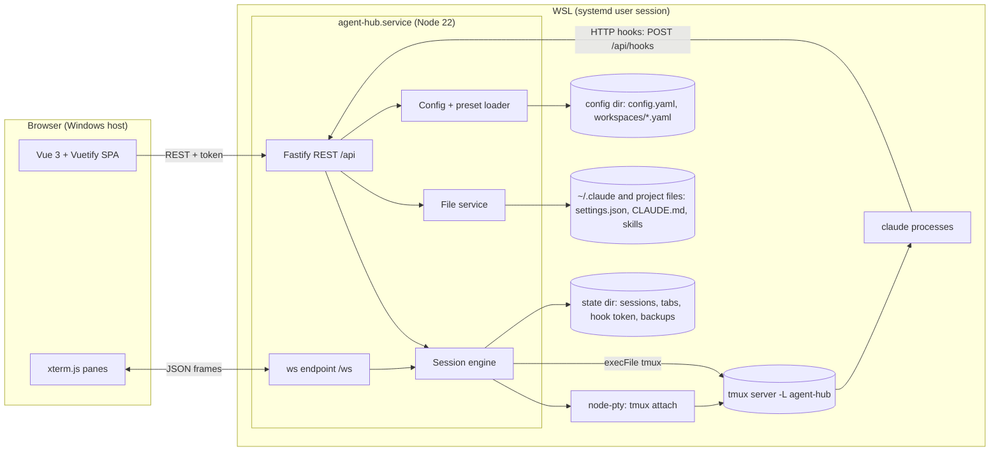
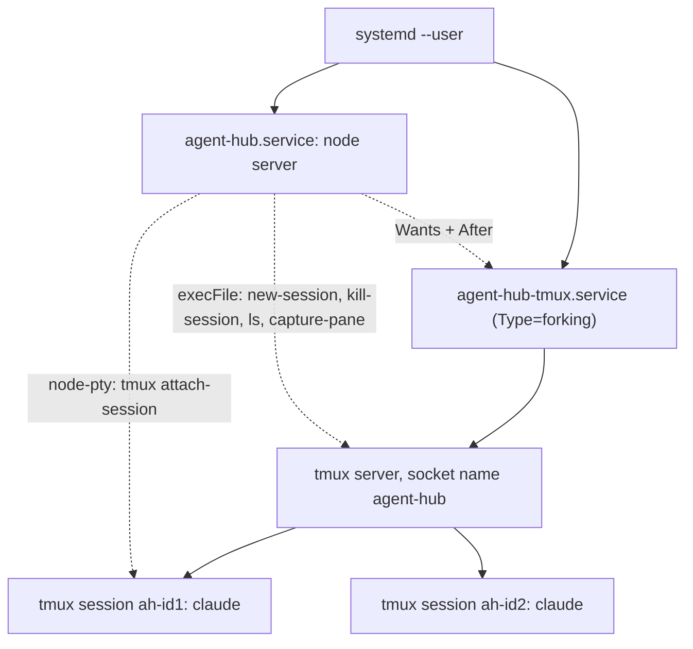
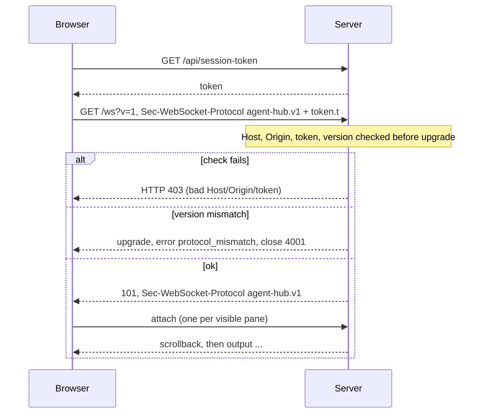
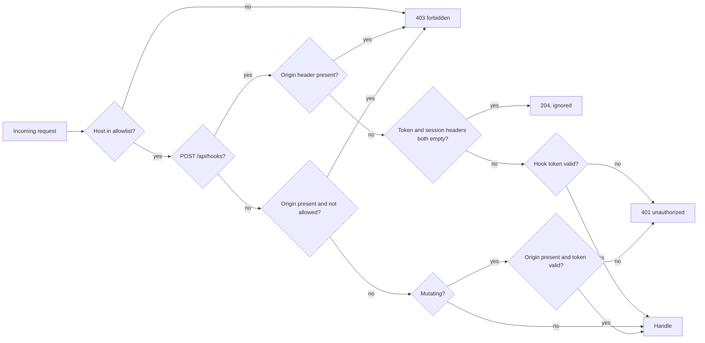
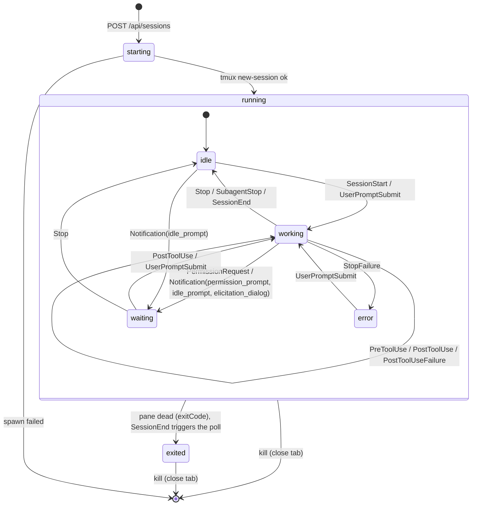
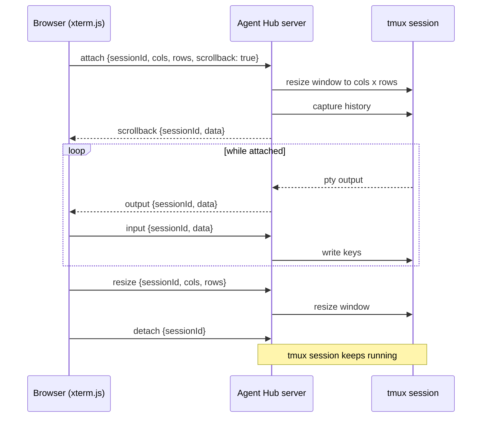

# Agent Hub architecture

Agent Hub is a local web app running inside WSL that manages Claude Code sessions. Each session runs in its own tmux session; the browser shows them as terminal panes arranged in tabs. Decisions behind this document are recorded in [`adr/`](adr/).

Statements about Claude Code behavior that could not be verified from its documentation are marked **assumed** together with the task that has to verify them.

## Overview



| Component | Responsibility |
| --- | --- |
| SPA (`apps/web`) | Tabs, split panes, preset/skill/MCP editors. Talks REST for CRUD and one WebSocket for terminal I/O and live state. |
| Fastify server (`apps/server`) | REST API, WebSocket endpoint, static file serving of the built SPA, Host/Origin/token checks. |
| Session engine | Creates, attaches, resizes, kills and re-adopts tmux sessions; fans out pty output to WS clients; derives session state from hooks. |
| File service | The only code path that writes files outside the state directory (see [File-write policy](#file-write-policy)). |
| tmux | Owns every session process. The server can crash or restart without killing a single session. |
| Claude Code | Runs inside tmux; reports activity back through HTTP hooks merged into its settings. |

## Process model



- **Server.** Runs as the systemd user service `agent-hub.service` inside WSL (`Restart=on-failure`, `Wants=` and `After=agent-hub-tmux.service`), installed by `install.sh` (T60). It binds `127.0.0.1:<port>` only (`BIND_HOST`, `resolvePort`). In development `pnpm dev` runs it with `tsx watch` instead.
- **One tmux server** with the dedicated socket name `agent-hub` (`tmux -L agent-hub ...`), so the user's own tmux sessions are never listed, touched or killed. It is owned by its own user unit `agent-hub-tmux.service` (`Type=forking`, `ExecStart=tmux -L agent-hub -f %S/agent-hub/tmux.conf start-server`), so restarting or stopping `agent-hub.service` never kills sessions.
- **tmux.conf** (`$STATE/tmux.conf`, written by the installer): `exit-empty off` (server stays up without sessions), `remain-on-exit on` (exit codes stay readable), status line off, large `history-limit` for scrollback, `window-size latest`. tmux reads it only when the tmux server starts; changes need a restart of `agent-hub-tmux.service`.
- **The engine never starts the tmux server.** Every `execFile` call passes `tmux -N` (never start a server). If the socket is missing it reports `tmux_unavailable` (`ApiErrorCodeSchema`, HTTP 503), refuses to create sessions and keeps retrying the listing. In development the developer starts it with the same command.
- **No alternate screen.** When the tmux server becomes available, the engine appends `xterm-256color:smcup@:rmcup@` to the server option `terminal-overrides` (once), so the attach pty never switches xterm.js to the alternate buffer and scrollback written before the redraw stays visible.
- **Requirements:** tmux 3.2 or later (`new-session -e`); the installer checks `tmux -V`. The installer runs `loginctl enable-linger` so user units run without a login session, and documents that WSL shuts the VM down when idle, which ends all sessions (assumed, verify in T60).
- **One tmux session per Agent Hub session**, running exactly one command (default `claude`) in one window and pane. Agent Hub layouts (splits, tabs) are drawn in the browser, never with tmux panes.
- **One pty per attached session.** When the first client attaches, the engine spawns `tmux -L agent-hub attach-session -t =ah-<id>` with node-pty and fans its output out to every attached WS client. When the last client detaches, the pty is closed; the tmux session keeps running. tmux therefore only ever sees one client per session, and the pty size is the session size.
- **All other tmux calls** (`new-session`, `kill-session`, `list-sessions`, `list-clients`, `display-message`, `capture-pane`, `refresh-client`, `show-options`, `set-option`) use `execFile` with argument arrays. Targets use the exact-match form because tmux otherwise prefix-matches names: `=ah-<id>` for session targets (`kill-session`, `attach-session`), `=ah-<id>:` for window and pane targets (`display-message`, `capture-pane`, `list-clients`).

### Lifecycle operations

| Operation | What happens |
| --- | --- |
| Create (REST or preset autostart) | Generate id, write metadata (`lifecycle: starting`), `new-session -d -s ah-<id> -c <cwd> -x <cols> -y <rows> -e AGENT_HUB_HOOK_TOKEN=<token> -e AGENT_HUB_URL=http://127.0.0.1:<port> -e AGENT_HUB_SESSION_ID=<id> -- env -- <command> <args...>` (`env --` because tmux runs a single-word command through `sh -c`), then `running`; broadcast `session.created`. `cwd` must be an existing directory (`400 bad_request`). Failure: `session_spawn_failed`, metadata removed. |
| Browser closed | Nothing. Sessions keep running; the pty closes when no client is attached. |
| Close app tab | Client asks for confirmation (`confirmCloseTab`), then `DELETE /api/sessions/:id` per pane: `kill-session -t =ah-<id>`, metadata deleted, `session.removed` broadcast. |
| Command exits | Pane stays dead (`remain-on-exit`); engine sets `lifecycle: exited` with `exitCode` from `#{pane_dead_status}`. The session stays visible until the user closes it. |
| Server restart | Re-adoption, see below. |

Exit detection polls one `list-sessions` call (the re-adoption format below, which includes `pane_dead`, `pane_dead_status` and `pane_dead_signal`) for all sessions. A dead pane is `exited` at once; `exitCode` is the status, or `128 + signal` for a killed command, and is added by a later `state` frame when tmux reaps the process after marking the pane dead. Polling runs every 1 s while any session is attached, every 5 s otherwise; a session missing from the listing is removed (`session.removed`); sessions created after a listing started are left alone by it. If the shared pty exits unexpectedly, a fresh listing runs: a vanished session is removed, otherwise its clients get `error tmux_unavailable` (or `internal` when tmux is still up) and are detached. `GET /api/health` reports `tmux: available | unavailable`. The `SessionEnd` hook is only a hint that triggers an early poll (`engine.poll()`). A tmux `pane-died` hook calling back into the server is an optional later optimization.

### Re-adoption after restart

On startup the engine runs `tmux -L agent-hub list-sessions -F '#{session_name}\t#{session_created}\t#{session_path}\t#{pane_dead}\t#{pane_dead_status}\t#{pane_dead_signal}\t#{pane_start_command}'` (no server running = `tmux_unavailable`) and reconciles it with `$STATE/sessions/*.json`:

| tmux session | Metadata | Result |
| --- | --- | --- |
| `ah-<id>` exists | `sessions/<id>.json` exists | Adopted: `lifecycle` from `pane_dead`, `state` reset to `idle` until the next hook arrives. |
| `ah-<id>` exists | missing (orphan) | Adopted with reconstructed metadata (below). Never killed automatically. |
| missing | `sessions/<id>.json` exists | Stale record deleted. Clients still referencing the id get `unknown_session` and drop the pane. |
| name without `ah-` prefix | - | Ignored, never touched (someone used the socket manually). |

Reconstructed orphan record: `cwd` from `session_path`, `createdAt` from `session_created`, `title: "Recovered"`. `pane_start_command` is a shell-quoted string that cannot be split back reliably, so it is only logged and the record stores `command: 'tmux'`, `args: []`. Required fields without a source get defaults: `cols` 80, `rows` 24, `state: idle`, `lastEventAt` now, `hostId: local`. Recovered sessions are shown in a synthetic "Recovered" tab. When loading `tabs.json` the server prunes session ids that no longer exist.

Re-adopted sessions keep the environment they were created with, which is why the hook token is persisted and not per boot (see [Security model](#security-model)).

## Naming and storage

### Session ids and tmux names

- Session ids are generated by the server: 12 characters of `crypto.randomBytes(9).toString('base64url')`, so the charset is `[A-Za-z0-9_-]`, the same as `TmuxSessionNameSchema`.
- tmux session name: `ah-<sessionId>` (`Session.tmuxSession`). The prefix marks sessions as ours during re-adoption and guarantees a name never starts with `-`.
- `SessionIdSchema` enforces the charset above, so every valid id yields a valid `tmuxSession`.

### Where things live

| Path | Content | Writer |
| --- | --- | --- |
| `$XDG_CONFIG_HOME/agent-hub/config.yaml` (default `~/.config/agent-hub/`) | `AppConfigSchema` | user + server (`PATCH /api/config`) |
| `.../agent-hub/workspaces/<name>.yaml` | `WorkspacePresetSchema`, file name = `name` | user + server (preset API) |
| `$XDG_STATE_HOME/agent-hub/` (default `~/.local/state/agent-hub/`, called `$STATE`) | runtime state, mode `0700` | server only |
| `$STATE/sessions/<id>.json` | one `Session` record, rewritten on every lifecycle or state change | server |
| `$STATE/tabs.json` | runtime tabs (`AppTabSchema[]`) incl. pane sizes, so tabs survive browser close | server |
| `$STATE/hook-token` | hook token, mode `0600`, created once | server |
| `$STATE/tmux.conf` | tmux config, read by `agent-hub-tmux.service` at tmux start | installer |
| `$STATE/backups/<encoded-path>/<timestamp>` | backups before overwriting or deleting files (see below) | server |
| journald (`journalctl --user -u agent-hub`) | logs (pino to stdout) | server |

The state directory follows the XDG base directory spec the same way `resolveConfigDir` does for config: `$XDG_STATE_HOME/agent-hub` when set, otherwise `~/.local/state/agent-hub` (`resolveStateDir(env)` in `packages/shared`).

## WebSocket runtime behavior

The frame catalogue is in [Shared contracts](#websocket-protocol). This section defines how the server and client use it.

### Connection lifecycle



1. Before every connect the client fetches the current per-boot token from `GET /api/session-token` (route name fixed, added to `API_ROUTES` in T11). It opens one socket per browser tab at `/ws?v=<WS_PROTOCOL_VERSION>` with the subprotocols `agent-hub.v1` and `token.<token>` (`new WebSocket(url, ['agent-hub.v1', 'token.' + token])`). The server validates the token entry and echoes only `agent-hub.v1`. Browsers cannot set other headers on WebSocket requests; the subprotocol header keeps the token out of URLs and access logs.
2. It sends `attach` for every pane that is visible. Hidden app tabs are detached to save bandwidth and re-attached when shown.
3. `session.created`, `session.removed` and `state` frames are broadcast to every connection, attached or not, so sidebars stay current.
4. Invalid frames get `error bad_message` and are ignored; the connection stays open.

### Attach and scrollback ordering

For each `attach {sessionId, cols, rows, scrollback}`:

1. Unknown id: `error unknown_session`.
2. Register the client on the session; spawn the pty if it is the first client. Live output for this client is buffered from now on.
3. Apply the size (resize rule below).
4. If `scrollback` is `true`: read `#{history_size}` (`display-message -p -t =ah-<id>:`); if it is not 0, `capture-pane -p -e -J -S -<min(history_size, 10000)> -E -1 -t =ah-<id>:` (history above the visible screen, with escape sequences; tmux swaps `-S`/`-E` on an empty history, hence the check). Line feeds become `\r\n` and the result is sent as one `scrollback` frame. The client resets its xterm before writing it.
5. Ask tmux to redraw the visible screen: read the pty's client tty with `list-clients -t =ah-<id>: -F '#{client_tty}'`, then `execFile tmux refresh-client -t <client_tty>`. Flush the buffered output and stream `output` frames. The redraw goes through the shared pty, so every viewer of that session receives it; it is a harmless repaint.

The visible screen always comes from tmux's redraw, so it is never duplicated. Lines that scroll off the screen exactly between capture and redraw may be missing from history; this is accepted for v1.

`input` or `resize` for a session the connection is not attached to returns `error not_attached`.

### Resize rule

A tmux session has one size. The last `attach` or `resize` from any client wins: the engine resizes the pty (and with it the tmux client), and all other attached clients render at that size. Values are bounded by `MAX_TERMINAL_SIZE`. The client debounces resize events (fit addon) before sending.

### Backpressure

v1 has no flow-control frames. Per connection the server keeps one pending output string per session:

| Condition | Action |
| --- | --- |
| `ws.bufferedAmount` below 1 MiB | Send `output` immediately. |
| at or above 1 MiB | Coalesce: append to the pending string for that session and flush it as one frame when the buffer drains (checked on a short timer). |
| pending output for one connection above 8 MiB | The client is too slow: close the connection with code `4008`. The client reconnects and re-attaches with `scrollback: true`, which resynchronizes the screen. |

The policy is coalesce, then close with `4008`; output is never dropped, because dropping escape sequences corrupts the terminal. The pty itself is never paused in v1, since it is shared by all clients of a session. Protocol v2 reserves `pause`/`resume` frames for real per-client flow control.

### Limits, heartbeat, close codes

- `maxPayload`: 1 MiB per incoming frame (large pastes fit; larger frames close the connection with `1009`).
- Heartbeat: the server sends a WebSocket ping every 30 s and terminates connections that missed the previous pong. The client sends the app-level `ping` every 25 s and treats a missing `pong` after 10 s as a dead connection.
- Close codes: `1000` normal, `1001` server shutdown, `1009` frame too large, `4001` protocol mismatch, `4008` slow consumer.

### Reconnect semantics

- The client reconnects automatically with exponential backoff (0.5 s doubling to 10 s, with jitter), except after `4001` (reload the page to get a matching client).
- After reconnect it re-sends `attach` with `scrollback: true` for every visible pane and refetches `GET /api/sessions`, because `session.created`/`session.removed` frames during the outage were missed.
- Server restart looks like a reconnect: sessions were re-adopted, so attaching works unchanged. The per-boot token changed, so the client always refetches it before connecting. `GET /api/health` `protocolVersion` tells the client whether it must reload.
- REST calls that fail with `401` or `403` refetch the token once and retry once; a second failure is shown to the user.
- Graceful shutdown closes all sockets with `1001` and all ptys; tmux sessions are left running.

## File-write policy

`$CLAUDE_DIR` is `$CLAUDE_CONFIG_DIR` when set, otherwise `~/.claude`; the server honors it everywhere it reads or writes Claude Code files. The server writes only these files; everything else is read-only:

| Target | How | Notes |
| --- | --- | --- |
| Own config: `config.yaml`, `workspaces/*.yaml` | File service, atomic | YAML written through the `yaml` Document API so user comments and unknown keys survive. Preset file name must equal `PresetNameSchema`. |
| Own state: `$STATE/**` | Atomic | No conflict check (server is the only writer). |
| Claude settings: `$CLAUDE_DIR/settings.json` | Merge `hooks` key only, atomic, conflict-checked | Adds Agent Hub hook entries if missing; never changes or removes other entries or keys. Agent Hub's entries are identified by their exact URL `http://127.0.0.1:<any port>/api/hooks`, never by an extra key. Uninstall removes only those entries (and groups, event keys or the `hooks` key it emptied), so install then uninstall restores the file byte for byte when it uses one consistent indentation. The port is baked into that URL, so a port change re-merges the entries; running Claude Code sessions pick up hook edits live. Invalid JSON (including comments) is `409 conflict` and never rewritten. Symlinks are followed. |
| `CLAUDE.md` and skills | File service, atomic, conflict-checked | Only inside allowlisted scopes: global `$CLAUDE_DIR/CLAUDE.md` and `$CLAUDE_DIR/skills/**`; for each configured project and its git worktrees `<root>/CLAUDE.md`, `<root>/CLAUDE.local.md`, `<root>/.claude/skills/**`. |
| MCP servers | `claude mcp add-json` / `claude mcp remove` via `execFile` (verified subcommands) | Never edit `~/.claude.json` or `.mcp.json` directly; the CLI owns their format. There is no update command: an edit is remove + add, which is not atomic (a failed add leaves the server removed; the UI reports it and offers to retry). Removing a remote (`http`/`sse`) server also drops its stored OAuth tokens, so the user must re-authenticate; the UI warns before editing one. |
| Worktree helper | Copy gitignored files into a new worktree | Only after explicit confirmation, target must be inside the worktree (T34). |

### Rules

- **Atomic write:** write `<dir>/.<name>.agent-hub-<random>.tmp` in the same directory (same filesystem), copy the target's mode, `fsync`, `rename` over the target. A crash leaves either the old or the new file, never a partial one.
- **Conflict detection:** every read returns `mtimeMs` and the sha256 `hash` of the content. Writes carry the hash they are based on as `expectedHash` (omitted only for a new file); the server compares it under a per-path lock and re-hashes the target once more right before the rename. Mismatch (or file created/deleted meanwhile) returns `409 conflict` with `{ currentHash }`, and the UI shows a diff or reload choice.
- **Never silent overwrite:** there is no force flag in the API. Overwriting after a conflict needs a fresh read. External changes are pushed to the UI by a file watcher (T31).
- **Symlinks:** the requested path must match a managed pattern. It is resolved with `realpath`, and the resolved path must stay inside the same scope root, contain no hidden segment (apart from the `.claude/skills` prefix) and be a managed file or a `.md` file, so `CLAUDE.md -> AGENTS.md` works while links to `package.json`, `.git/**` or `.claude/settings.json` are `403`. Writes go to the resolved target, so the link itself is kept; deleting a link removes only the link. New files are never created through a dangling link. Every component below the root is re-checked with `lstat` before writing, and anything but a regular file (FIFO, device) is `403`; files are opened with `O_NOFOLLOW | O_NONBLOCK`.
- **Hard links (accepted):** a managed file that is a hard link to a file elsewhere cannot be detected by path checks; writes replace the managed name via rename, so the other name keeps the old content. Creating such a link needs local access, which is out of scope.
- **Backups:** before the server overwrites or deletes a file it does not exclusively own (Claude settings, CLAUDE.md, skills, presets, `config.yaml`), the previous content is copied to `$STATE/backups/<encoded-path>/<timestamp>` with mode `0600` (default `~/.local/state/agent-hub/backups`; startup fails if it lies inside a scope). A deleted skill directory is backed up file by file; it is only removed when it holds nothing but managed files, otherwise `409 conflict` lists the blocking entries. Retention: the last 20 backups per file and at most 50 MB in total; the oldest backups are pruned first.

## Security model

Agent Hub is a single-user tool on loopback. The main attacker is a web page open in the same browser, not another user on the machine. The Origin check is the primary CSRF control; the token is defense in depth. `POST /api/hooks` takes its own path (hook token, see below). All request checks live in `apps/server/src/security/` and run in one `onRequest` hook (`registerSecurity`) before routing, so they also cover unknown routes.



| Control | Rule |
| --- | --- |
| Loopback bind | `127.0.0.1` only (`BIND_HOST`), not configurable. After `listen`, `startServer` asserts that the bound address is `127.0.0.1` and closes the server otherwise (the process exits 1). WSL localhost forwarding makes it reachable from the Windows browser (assumed, verify in T60). |
| Host allowlist | `localhost:<port>`, `127.0.0.1:<port>`, `[::1]:<port>` and bare `localhost` (case-insensitive), else `403 forbidden` on every route. Blocks DNS rebinding, where an attacker domain resolves to 127.0.0.1. No dev Host is allowed: in development the UI on `:3000` reaches the server only through the Vite proxy (`/api` and `/ws`, `changeOrigin: true`, `ws: true`; config lands in T22), which rewrites Host to the server's. Reusable as `isAllowedHost(host, port)`. |
| Origin allowlist | Checked on every request that carries `Origin`, and required on every mutating request except `POST /api/hooks`. Allowed: exactly `http://localhost:<port>`, `http://127.0.0.1:<port>` or `http://[::1]:<port>`; with `NODE_ENV=development` also `http://localhost:3000` / `http://127.0.0.1:3000` (Vite). A mismatch, including `null`, is `403`; a missing `Origin` on a mutation is `401`. Reads without `Origin` pass. No CORS headers are ever sent. Reusable as `isAllowedOrigin(origin, port, dev)`. |
| Per-boot token | `randomBytes(32)` base64url generated at startup, kept in memory, new on every restart. Required as `X-Agent-Hub-Token` (`SESSION_TOKEN_HEADER`) on every `POST`/`PUT`/`PATCH`/`DELETE` (except `POST /api/hooks`) and as `token.<t>` subprotocol on `/ws`; compared in constant time (SHA-256 + `timingSafeEqual`); missing or wrong is `401 unauthorized`. `GET /api/health` stays token-free. The SPA fetches it from `GET /api/session-token` (`SessionTokenResponseSchema`) before every WS connect and once more after any `401`/`403`. That route sits behind the Host and Origin checks and also rejects `Sec-Fetch-Site: cross-site`; without CORS headers other origins cannot read it. |
| WebSocket upgrade | `authorizeUpgrade(req, { port, token, dev })`: Host allowed, `Origin` present and allowed, `Sec-WebSocket-Protocol` offers `agent-hub.v1` (`WS_SUBPROTOCOL`) and exactly one `token.<token>`. The server echoes only `agent-hub.v1`. No token in the query string. |
| Hook token | Separate random token in `$STATE/hook-token` (`0600`), stable across restarts because re-adopted sessions keep their environment. Only valid on `POST /api/hooks` (`API_ROUTES.hooks`), which is exempt from the per-boot token (`POST` only; other methods need it) and rejects any request that carries an `Origin` header (Claude Code sends none; browsers always do). The route checks `X-Agent-Hub-Hook-Token` (`HOOK_TOKEN_HEADER`, constant time, `401` otherwise) before the body is parsed; a request with both hook headers empty comes from a Claude session not started by Agent Hub and gets `204`. |
| Process spawning | `run(file, args, { cwd, timeoutMs, maxBuffer, env })` in `src/process/exec.ts`: `spawn` with an argument array, `shell: false` and `detached: true` (own process group); on timeout or output overflow the whole group gets `SIGKILL`. Rejects with `RunError` (`exit`/`signal`/`timeout`/`max-buffer`/`spawn`) unless exit code 0. The child env is `PATH`, `HOME`, `LANG`, `LC_ALL`, `USER`, `TMPDIR`, `SHELL` from the server env, overridden by the caller's `env`. node-pty also takes argument arrays only; commands after `--` in `new-session`. ESLint bans in `apps/server`: `exec`/`execSync` imports, default/namespace/dynamic `child_process` imports, a `shell` option other than `false` in `spawn`/`execFile`/`fork` calls, and options passed as a variable or spread there. |
| Path allowlist | `createAllowlist(roots).resolveInside(candidate)` in `src/fs/allowlist.ts`: rejects empty, relative and NUL-byte paths, `~`-expands, `path.resolve`s, then `realpath`s the candidate (or its nearest existing parent for new files) and checks it against the `realpath` of each root (`path.relative`, no `..` segment). `..` and symlink escapes, and paths through dangling links, fail with `403 forbidden`. Callers must use the returned path; writers use temp file + rename in the resolved directory (TOCTOU). |
| Security headers | Every response: `X-Content-Type-Options: nosniff`, `Referrer-Policy: no-referrer`; `/api/*` also `Cache-Control: no-store`. A strict CSP for the SPA is not set yet; it comes with serving the built web client. |
| No secrets to the browser | MCP `env` values and `headers` are masked (`***`) in API responses; an unchanged mask on save keeps the stored value. |
| Logging | pino `redact` removes the `authorization`, `x-agent-hub-token`, `x-agent-hub-hook-token` and `sec-websocket-protocol` request headers. Query strings carry no secrets. |
| Validation | Every REST body and WS frame is parsed with strict zod schemas; unknown keys fail. |

### Threats

| Threat | In scope | Mitigation |
| --- | --- | --- |
| Malicious web page sends requests to `localhost:7337` (CSRF) | yes | Origin check (required on mutations) + per-boot token |
| DNS rebinding | yes | Host allowlist |
| Cross-site WebSocket hijacking | yes | Origin check + token in `Sec-WebSocket-Protocol` on upgrade |
| Path traversal / symlink escape via file API | yes | realpath + allowlist |
| Command injection via session `command`/`args`/`cwd` | yes | `execFile` only, zod validation, ESLint ban on shells |
| Secret leakage (MCP env, tokens) to page or logs | yes | Masking, log redaction |
| Forged hook events from a web page | yes | Hook token + session id header, requests with `Origin` rejected, no CORS |
| Hook token readable from session environment | accepted | Visible to the same user and to child processes of the session; impact is forged session status only |
| Oversized frames / memory exhaustion | yes | `maxPayload`, backpressure limits, 1 MiB body limit, bounded `run()` output |
| Exposure to the LAN | yes | Loopback bind only, asserted after listen; user-made port proxies are out of scope |
| Other local processes of the same user | no | They can already read `~/.claude` and run `claude` |
| Other OS users on a shared machine | no | v1 targets personal machines; the token is only a partial barrier |
| Malicious repository content (CLAUDE.md, skills, MCP servers in a project) | no | Claude Code's own trust model applies |
| Supply-chain attacks on dependencies | partly | Lockfile with `--frozen-lockfile` in CI, Dependabot update PRs |

## Session state machine

`lifecycle` (process) and `state` (activity) are independent fields of `Session`. `state` only has meaning while `lifecycle` is `running`; on `exited` it keeps its last value and the UI shows the exit instead. `stateSince` records when `state` last changed (creation, re-adoption or a hook that changed it); the UI derives its elapsed timer from it and pulses the badge once on `waiting`.



### Hook mapping

Claude Code supports `http` hooks that POST the hook input JSON (`Content-Type: application/json`) to a URL, configured in `$CLAUDE_DIR/settings.json`. Agent Hub installs one matcher group per event below into the user settings, each with this handler:

```json
{
  "type": "http",
  "url": "http://127.0.0.1:<port>/api/hooks",
  "headers": { "X-Agent-Hub-Session-Id": "$AGENT_HUB_SESSION_ID", "X-Agent-Hub-Hook-Token": "$AGENT_HUB_HOOK_TOKEN" },
  "allowedEnvVars": ["AGENT_HUB_SESSION_ID", "AGENT_HUB_HOOK_TOKEN"],
  "timeout": 5
}
```

The `Notification` group carries `"matcher": "permission_prompt|idle_prompt|elicitation_dialog"` (exact match), all other groups have no matcher. Installing is explicit (`POST /api/hooks/install`, later a Settings toggle) and idempotent; `POST /api/hooks/uninstall` removes only these handlers; both back up the previous file first (see [File-write policy](#file-write-policy)). `GET /api/hooks/status` reports `installed`, `portMatches`, `installedEvents` and `statusAvailable` with `reasons`.

New sessions get `AGENT_HUB_SESSION_ID`, `AGENT_HUB_HOOK_TOKEN` and `AGENT_HUB_URL` through `tmux new-session -e`. Re-adopted sessions keep the environment they were started with; sessions started before the hook token existed, or whose server port changed, report nothing until they are restarted. Claude sessions not started by Agent Hub resolve both headers to empty strings and get `204`; they change nothing.

`POST /api/hooks` always answers fast and without a body: `204` (accepted, unknown session, invalid session id or unparseable payload, all ignored) or `401` (wrong hook token). An empty 2xx is a plain success for Claude Code; a JSON body would be parsed as hook output. Its body limit is 16 MiB because tool payloads can exceed the global 1 MiB.

| Hook event (matcher) | New `state` | Verified |
| --- | --- | --- |
| `SessionStart` | `working` | event yes; mapping per T26 brief, see ADR 0007 |
| `UserPromptSubmit`, `PreToolUse`, `PostToolUse`, `PostToolUseFailure` | `working` | events yes |
| `PermissionRequest` | `waiting` | event yes |
| `Notification` (`permission_prompt`, `idle_prompt`, `elicitation_dialog`) | `waiting` | matcher values and `notification_type` input field yes |
| `Stop`, `SubagentStop` | `idle` | events yes |
| `StopFailure` | `error` | event yes |
| `SessionEnd` | `idle`, plus an early exit poll (`engine.poll()`) | event yes |
| all others | no change | - |

`mapHookEvent` in `packages/shared/src/hooks.ts` is the single source of this table. Each accepted hook for a `starting` or `running` session sets `lastEventAt` (a hook can arrive before `tmux new-session` returns); only a changed `state` also sets `stateSince`, persists the record and broadcasts a `state` frame (so `lastEventAt` on disk may lag). Events for `exited` sessions are ignored.

These Claude Code settings can disable status reporting; `GET /api/hooks/status` checks the user settings file plus `/etc/claude-code/managed-settings.json` and `managed-settings.d/*.json` and lists every hit: `disableAllHooks: true`, `allowManagedHooksOnly: true` (managed only), `allowedHttpHookUrls` without a pattern matching the hook URL (`*` wildcard, lists merged), `httpHookAllowedEnvVars` without both variables. Project settings depend on the session directory and are not checked.

Verified in the Claude Code hooks and settings references (2026-10-27):

- `http` handler fields `url`, `headers` (`$VAR` / `${VAR}` interpolation), `allowedEnvVars` (unlisted variables become empty strings), `timeout` (seconds; default 600), the event names and `Notification` matcher values used above.
- Non-2xx, connection failure and timeout are non-blocking errors; an empty 2xx is success.
- Settings files are strict JSON; a value the schema rejects is a Settings Error for the whole file, so Agent Hub adds no marker keys to handlers.
- Identical handlers defined in several settings files run once; settings edits, including hooks, apply to running sessions.

Assumed, verify in T50 or with a live session:

- A variable listed in `allowedEnvVars` but unset in the environment yields an empty header (documented only for unlisted variables).
- `PostToolUse` after an approved permission prompt reliably moves `waiting` back to `working`; a denied prompt is followed by `Stop` or `UserPromptSubmit`.
- Latency a slow or unreachable endpoint adds per event within the 5 s timeout (`SessionEnd` hooks share a 1.5 s budget).
- Agent-team events (`TeammateIdle`, `TaskCreated`, `TaskCompleted`) need their own mapping behind `experimental.agentTeams` (T50).
- The minimum Claude Code version that supports `http` hooks and `StopFailure`; the reference states none.

## Repo layout and build

```text
apps/
  server/          Fastify server (TS, tsx in dev, tsc build to dist/)
  web/             Vue 3 + Vuetify SPA (Vite, port 3000 in dev)
packages/
  shared/          zod schemas, types, defaults (@agent-hub/shared, built to dist/)
docs/
  architecture.md  this file
  adr/             architecture decision records
  design-system/   tokens.json, Motion.md, component specs
examples/          config.yaml and preset examples, validated by tests
```

| Command | Effect |
| --- | --- |
| `pnpm dev` | Builds `@agent-hub/shared`, then runs in parallel: shared `tsc --watch`, server `tsx watch`, web Vite dev server. Vite proxies `/api` and `/ws` to the server port (set up with the server skeleton). |
| `pnpm build` | `tsc` for shared and server, `vite build` for web. In production the server serves `apps/web/dist` and the SPA uses relative URLs, so one origin serves everything. |
| `pnpm lint` / `pnpm typecheck` / `pnpm test` | ESLint (flat config, `eslint-config-vuetify` + `typescript-eslint`), `tsc`/`vue-tsc --noEmit`, vitest per package. |
| `pnpm e2e` | Playwright end-to-end tests in `apps/web`. |

TypeScript is strict everywhere (`tsconfig.base.json`: `strict`, `noUncheckedIndexedAccess`). Node 22 and pnpm 11 are the minimum (`engines`).

Design tokens flow from `docs/design-system/tokens.json` through a build script into a generated Vuetify theme, CSS variables and an xterm theme (see `docs/design-system/README.md`); generated files are never edited by hand.

**CI** (`.github/workflows/ci.yml`): runs on push to `main` and on every pull request, cancels superseded runs, read-only token permissions, Node 22 with pnpm cache.

| Job | Steps |
| --- | --- |
| `check` | install tmux, `pnpm install --frozen-lockfile`, `pnpm lint`, `pnpm typecheck`, `pnpm test`, `pnpm build` |
| `e2e` (after `check`) | install, cached Playwright Chromium, build `@agent-hub/shared`, `pnpm e2e`; uploads the Playwright report on failure |

Dependabot (`.github/dependabot.yml`) opens dependency update pull requests. Required status checks for merging are a repository setting, not part of the repo.

## Shared contracts

All contracts live in `packages/shared` (`@agent-hub/shared`) as zod schemas. Every schema is exported as `XSchema` with its inferred type `X` (and `XInput` where defaults make input and output differ). Server and web client import the same schemas, so validation and types never drift.

### Strict vs. passthrough

| Where data comes from | Unknown keys | Why |
| --- | --- | --- |
| REST bodies, WS frames, sessions, runtime tabs | rejected (`z.strictObject`) | Typos and protocol drift fail loudly at the boundary. |
| User files: `config.yaml`, preset YAML, MCP entries, layouts | kept (`z.looseObject`) | Users may add keys from newer versions or their own notes; a load/save cycle must not lose them. |

The REST wrappers around presets (`{ preset }`) are strict, but the preset itself stays loose, so `GET` then `PUT` keeps user-added keys. `ConfigPatchSchema` is strict because it is an API body, not a file.

### Product defaults (`defaults.ts`)

| Constant | Value |
| --- | --- |
| `DEFAULT_PORT` | `7337` (env `AGENT_HUB_PORT` overrides: digits only, 1-65535, otherwise startup fails; see `resolvePort`) |
| `BIND_HOST` | `127.0.0.1` (never configurable) |
| `DEFAULT_HOST_ID` | `local` (single user in v1, field kept for multi-user later) |
| `DEFAULT_COMMAND` | `claude` |
| `DEFAULT_COLS` / `DEFAULT_ROWS` | `120` / `30` |
| `MAX_TERMINAL_SIZE` | `1000` cols/rows |
| `MAX_PANES_PER_TAB` | `6` |
| `CONFIG_FILE` | `~/.config/agent-hub/config.yaml` |
| `WORKSPACES_DIR` | `~/.config/agent-hub/workspaces/*.yaml` |
| `resolveConfigDir(env)` | `$XDG_CONFIG_HOME/agent-hub` when set, otherwise `~/.config/agent-hub`; the constants above are the fallback |
| `DEFAULT_CONFIG` | equals `AppConfigSchema.parse({})` |
| `EXAMPLE_PRESET` | preset `project1`: 4 panes side by side in `~/git/project1` |

Paths may start with `~`; the server expands them.

### Schemas

| Module | Schema | Purpose |
| --- | --- | --- |
| `scope.ts` | `PathSchema` | Non-empty path, `~` allowed. |
| | `ScopeKindSchema`, `ScopeSchema` | `{ kind: global \| project \| worktree, path, branch?, projectPath? }`; `branch`/`projectPath` only for worktrees. |
| `config.ts` | `AppConfigSchema` | `config.yaml`: `port`, `experimental.agentTeams` (false), `confirmCloseTab` (true), `projects` (paths), `logLevel` (`info`), `theme` (`dark` \| `light` \| `system`, default `dark`). |
| | `ConfigPatchSchema` | Partial update; nested objects merge, arrays replace (`applyConfigPatch`). |
| | `PortSchema`, `LogLevelSchema`, `ThemeSchema` | Building blocks; `resolvePort(configPort, env)` applies `AGENT_HUB_PORT`, `resolveConfigDir(env)` applies `XDG_CONFIG_HOME`. |
| `session.ts` | `SessionSchema` | One session = one tmux session: `id`, `hostId`, `title?`, `cwd`, `command`, `args`, `tmuxSession`, `createdAt`, `state`, `lifecycle`, `exitCode?` (only when exited), `lastEventAt`, `stateSince?` (when `state` last changed; optional only for records written before it existed), `cols`, `rows`. Timestamps are ISO 8601 strings. |
| | `SessionStateSchema` | `working \| waiting \| error \| idle`, derived from Claude Code hooks. |
| | `SessionLifecycleSchema` | `starting \| running \| exited`. |
| `layout.ts` | `LayoutSchema` | `single \| row \| column \| grid-2x2 \| custom`; `custom` carries a split tree (`LayoutNodeSchema`) whose leaves point at pane indexes and carry relative `size` weights. |
| | `AppTabSchema`, `AppPaneSchema` | Runtime tab with 1-6 panes, each a `sessionId` plus optional `size`. |
| | `validateLayoutPanes` | `single` = 1 pane, `grid-2x2` = 4, `custom` must reference each pane exactly once. |
| `preset.ts` | `WorkspacePresetSchema` | Preset file: `name` (also the file name), `description?`, `autostart` (false), `tabs[]`. |
| | `PresetTabSchema`, `PresetPaneSchema` | Tab: `title?`, `layout` (default `row`; string shorthand `single \| row \| column \| grid-2x2` or the object form, `custom` needs the object), 1-6 panes. Pane: `cwd`, `command` (`claude`), `args` (`[]`), `title?`, `size?`. |
| `mcp.ts` | `McpServerSchema` | Discriminated by `transport`: `stdio` (`command`, `args`, `env?`) or `http`/`sse` (`url`, `headers?`); `scope` is `global \| project \| worktree`. |
| `api.ts` | `ApiErrorSchema` | Every non-2xx body: `{ code, message, details? }`; `validation_failed` requires `details: { path, message }[]` (`toValidationError`). |
| | REST schemas | See table below. |
| `hooks.ts` | `HookPayloadSchema`, `mapHookEvent` | Claude Code hook input (loose: only `hook_event_name`, `session_id?`, `notification_type?` are validated) and the event-to-state mapping, see [Hook mapping](#hook-mapping). |
| | `HookStatusSchema`, `HookChangeResponseSchema` | Hook install status and install/uninstall results. |
| `ws.ts` | `ClientMessageSchema`, `ServerMessageSchema` | WebSocket protocol, see below. |

Minimal preset (`~/.config/agent-hub/workspaces/project1.yaml`; full examples in `examples/`, validated by `examples.test.ts`):

```yaml
name: project1
tabs:
  - title: project1
    layout: row # shorthand for { kind: row }
    panes:
      - cwd: ~/git/project1
      - cwd: ~/git/project1
      - cwd: ~/git/project1
      - cwd: ~/git/project1
```

### REST API

All routes live under `/api` (`API_ROUTES`).

| Method and route | Request | Response |
| --- | --- | --- |
| `GET /api/health` | - | `HealthResponseSchema` (`status`, `name`, `version`, `protocolVersion`, `uptimeSec`, `tmux`) |
| `GET /api/sessions` | - | `ListSessionsResponseSchema` |
| `POST /api/sessions` | `CreateSessionRequestSchema` (`cwd`, `command`, `args`, `title?`, `cols`, `rows`) | `CreateSessionResponseSchema` |
| `DELETE /api/sessions/:id` | `SessionParamsSchema` | `KillSessionResponseSchema` |
| `GET /api/presets` | - | `ListPresetsResponseSchema` |
| `GET /api/presets/:name` | `PresetParamsSchema` | `PresetResponseSchema` |
| `POST /api/presets` | `UpsertPresetRequestSchema` | `PresetResponseSchema` |
| `PUT /api/presets/:name` | `UpsertPresetRequestSchema` (full replace) | `PresetResponseSchema` |
| `DELETE /api/presets/:name` | `PresetParamsSchema` | `DeletePresetResponseSchema` |
| `GET /api/config` | - | `GetConfigResponseSchema` |
| `PATCH /api/config` | `PatchConfigRequestSchema` | `PatchConfigResponseSchema` (`config`, `restartRequired`) |
| `POST /api/hooks` | Claude Code hook input (`HookPayloadSchema`), headers `X-Agent-Hub-Hook-Token`, `X-Agent-Hub-Session-Id` | `204` without body, or `401` |
| `GET /api/hooks/status` | - | `HookStatusSchema` |
| `POST /api/hooks/install` | `HookChangeRequestSchema` (empty) | `HookChangeResponseSchema` (`changed`, `status`) |
| `POST /api/hooks/uninstall` | `HookChangeRequestSchema` (empty) | `HookChangeResponseSchema` |

### WebSocket protocol

One connection per browser tab at `/ws?v=<WS_PROTOCOL_VERSION>` (currently `1`), multiplexing all sessions by `sessionId`. Each frame is one JSON text message with a `type` discriminator. On a version mismatch the server sends `error` with `protocol_mismatch` and closes the connection.

Terminal data (`input`, `output`, `scrollback`) is a plain UTF-8 string, not base64. Terminal I/O is almost entirely text, xterm.js consumes strings directly, and base64 would add a third more bytes plus encode/decode work per frame. The server decodes pty bytes with a streaming UTF-8 decoder, so multi-byte characters are never split across frames.

| Direction | `type` | Fields | Meaning |
| --- | --- | --- | --- |
| client to server | `attach` | `sessionId`, `cols`, `rows`, `scrollback` (default `true`) | Start streaming a session, resize it, optionally replay history first. |
| client to server | `detach` | `sessionId` | Stop streaming; the session keeps running in tmux. |
| client to server | `input` | `sessionId`, `data` | Keystrokes for the session. |
| client to server | `resize` | `sessionId`, `cols`, `rows` | Pane size changed. |
| client to server | `ping` | - | Keep-alive. |
| server to client | `output` | `sessionId`, `data` | Live terminal output. |
| server to client | `scrollback` | `sessionId`, `data` | History sent once after `attach`, before any `output`. |
| server to client | `state` | `sessionId`, `state`, `lifecycle`, `exitCode?`, `stateSince?` | Activity or lifecycle changed; the UI's elapsed timer counts from `stateSince`. |
| server to client | `session.created` | `session` | A session was created (by any client or a preset). |
| server to client | `session.removed` | `sessionId` | A session was killed or cleaned up. |
| server to client | `error` | `sessionId?`, `code`, `message` | `bad_message`, `protocol_mismatch`, `unknown_session`, `not_attached`, `tmux_unavailable`, `internal`. |
| server to client | `pong` | - | Answer to `ping`. |

`parseClientMessage` and `parseServerMessage` turn a raw text frame into a typed message or a readable error.



### Known risks

- **No WebSocket flow control in v1.** The server watches `bufferedAmount` per connection, coalesces output for slow clients and closes them with `4008` above 8 MiB pending (output is never dropped); `pause`/`resume` messages are reserved for protocol v2.
- **Frame size.** The server must set the ws `maxPayload` option so a single oversized client frame cannot exhaust memory.
- **Scrollback race.** While capturing scrollback after `attach`, the server buffers live output and sends it after the `scrollback` frame; the visible screen comes from a tmux redraw and is never duplicated (details in [Attach and scrollback ordering](#attach-and-scrollback-ordering)).
- **Multiple clients at different sizes.** A tmux session has one size; the last `attach` or `resize` wins and other attached clients render at that size.
