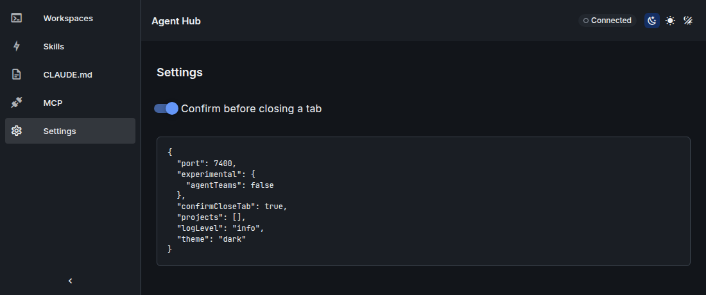

# Configuration

Agent Hub reads one app config file and one preset file per workspace. The server validates both with zod schemas from `packages/shared`. A missing config file means the defaults. An invalid `config.yaml` stops the server at startup with the path and the failing keys, so a typo is never ignored. An invalid preset file does not stop the server: it is left out of the preset list and answers `409` when it is opened.

Related: [Install guide](install.md), [Troubleshooting](troubleshooting.md).



## Files

| File or directory | Content | Written by |
| --- | --- | --- |
| `~/.config/agent-hub/config.yaml` | app config (keys below) | you, and the server on `PATCH /api/config` |
| `~/.config/agent-hub/workspaces/<name>.yaml` | one workspace preset per file; the file name is the preset `name` | you, and the server through the preset API |
| `~/.local/state/agent-hub/` | runtime state, mode `0700` | server only |
| `~/.local/state/agent-hub/sessions/<id>.json` | one record per session | server |
| `~/.config/agent-hub/teams/<name>.yaml` | team templates (experimental), see [Team templates](#team-templates) | you, and the server through the team template API |
| `~/.local/state/agent-hub/preset-launches.json` | preset name to the session ids it launched (autostart guard) | server |
| `~/.local/state/agent-hub/team-launches.json` | team template launches whose lead session is still live | server |
| `~/.local/state/agent-hub/hook-token` | hook token, mode `0600`, created once | server |
| `~/.local/state/agent-hub/tmux.conf` | tmux config for the Agent Hub tmux server | installer |
| `~/.local/state/agent-hub/backups/<encoded-path>/<timestamp>` | backups of Claude settings, CLAUDE.md, skills and presets before they are overwritten or deleted (mode `0600`, last 20 per file, at most 50 MB in total) | server |
| `$CLAUDE_CONFIG_DIR/settings.json` (default `~/.claude/settings.json`) | Claude Code settings; Agent Hub only adds or removes its own `hooks` entries | server, on hook install |
| `~/.claude.json` (`$CLAUDE_CONFIG_DIR/.claude.json` when set), `<project>/.mcp.json` | MCP server entries | server, through the `claude` CLI or a file edit |
| journald (`journalctl --user -u agent-hub`) | server logs | server |

The config and state directories follow `XDG_CONFIG_HOME` and `XDG_STATE_HOME` when they are set to absolute paths. A relative value is ignored.

Open tabs, pane sizes and the theme chosen in the UI are not files: the web app keeps them in the browser's `localStorage`.

## config.yaml

Keys, types and defaults come from `AppConfigSchema` in `packages/shared/src/config.ts` and `DEFAULT_CONFIG` in `packages/shared/src/defaults.ts`.

| Key | Type | Default | Description |
| --- | --- | --- | --- |
| `port` | integer, 1 to 65535 | `7337` | Port of the server on `127.0.0.1`. `AGENT_HUB_PORT` overrides it. A changed value takes effect after a restart. The installed unit always sets `AGENT_HUB_PORT`, so change the port there with `install.sh --port` (see [Port](install.md#port)). |
| `experimental.agentTeams` | boolean | `false` | Enables the experimental agent-team views (see [Agent teams](#agent-teams-experimental)). |
| `confirmCloseTab` | boolean | `true` | Ask for confirmation before closing a tab that still has running sessions (closing kills them). Also available as a switch in the Settings view. |
| `projects` | list of paths | `[]` | Project directories. Each project and its git worktrees become scopes for CLAUDE.md, skills and MCP servers. A leading `~` is expanded. |
| `logLevel` | `trace`, `debug`, `info`, `warn`, `error`, `fatal` | `info` | Server log level. |
| `theme` | `dark`, `light`, `system` | `dark` | Default UI theme. A theme chosen in the UI is stored in the browser and takes precedence there. |

Rules:

- Keys not listed above are kept when the server rewrites the file, so notes and newer keys survive.
- The server writes changes through the YAML document API, so comments and key order stay.
- `PATCH /api/config` accepts only the keys above (unknown keys are rejected). Changing `port` returns `restartRequired: true`.

Example (`examples/config.yaml`):

```yaml
# Example app config. Copy to ~/.config/agent-hub/config.yaml and adapt.
port: 7337
theme: dark
confirmCloseTab: true
experimental:
  agentTeams: false
projects:
  - ~/git/project1
```

## Environment variables

| Variable | Read by | Effect |
| --- | --- | --- |
| `AGENT_HUB_PORT` | server, Vite dev server | Port; overrides `port` in `config.yaml`. Only digits, 1 to 65535; any other value stops the server at startup. The Vite dev proxy forwards `/api` and `/ws` to this port (default `7337`) and does not read `config.yaml`. |
| `AGENT_HUB_DEV_ORIGINS` | server | Comma-separated extra Origins, each `http://localhost:<port>` or `http://127.0.0.1:<port>`. Honored only when `NODE_ENV=development`; other entries are logged and ignored. |
| `AGENT_HUB_WEB_DIST` | server | Directory of the built web app. Default: `apps/web/dist` next to the server. Without an `index.html` there, only the API is served. |
| `XDG_CONFIG_HOME` | server, installer | Base of the config directory (absolute values only). |
| `XDG_STATE_HOME` | server, installer | Base of the state directory (absolute values only). |
| `XDG_DATA_HOME` | installer | Base of the default install prefix (absolute values only). |
| `CLAUDE_CONFIG_DIR` | server | Claude Code config directory; default `~/.claude`. |
| `NODE_ENV` | server | `development` enables the Vite origins (`localhost:3000`, `127.0.0.1:3000`) and pretty logs. The systemd unit sets `production`. |
| `TMUX_TMPDIR` | server | Passed to tmux calls, so tmux finds the socket directory. |
| `AGENT_HUB_REPO` | installer | GitHub `<owner>/<repo>` to download releases from (default `Dev-Sebi/Paneful-Manager`). |

The server also sets these variables in every session it starts: `AGENT_HUB_SESSION_ID`, `AGENT_HUB_HOOK_TOKEN` and `AGENT_HUB_URL`. The hook handler in Claude Code uses them to report session state.

## Workspace presets

A preset describes tabs with panes. Each pane starts one command in one directory. Presets are files in `~/.config/agent-hub/workspaces/`, validated by `WorkspacePresetSchema` in `packages/shared/src/preset.ts`.

| Key | Type | Default | Description |
| --- | --- | --- | --- |
| `name` | string | required | Preset name, 1 to 64 characters, `[A-Za-z0-9][A-Za-z0-9_-]*`. Must equal the file name without `.yaml`. |
| `description` | string | none | Free text. |
| `autostart` | boolean | `false` | Launch the preset once when the server starts. It is skipped while one of the sessions it launched before is still live (not exited). |
| `tabs` | list | required, at least 1 | Tabs of the preset. |
| `tabs[].title` | string | none | Tab title. An untitled tab is named after the preset, with its position when the preset has several tabs. |
| `tabs[].layout` | layout | `row` | Arrangement of the panes (see below). |
| `tabs[].panes` | list | required, 1 to 6 | Panes of the tab. |
| `panes[].cwd` | path | required | Working directory. A leading `~` is expanded. The directory must exist when the session starts. |
| `panes[].command` | string | `claude` | Command started in the pane. |
| `panes[].args` | list of strings | `[]` | Arguments of the command. |
| `panes[].title` | string | none | Pane title. |
| `panes[].size` | positive number | equal share | Relative weight of the pane along its split. |

Layout shorthands:

| Layout | Panes | Arrangement |
| --- | --- | --- |
| `single` | exactly 1 | one pane |
| `row` | 1 to 6 | side by side |
| `column` | 1 to 6 | stacked |
| `grid-2x2` | exactly 4 | 2 by 2 grid |
| `custom` | 1 to 6, each index used once | tree of splits (object form only) |

A `custom` layout is an object with `kind: custom` and a `root` node. A node is either `{ type: pane, pane: <index>, size? }`, where `<index>` points at `panes[<index>]` of the tab, or `{ type: split, direction: row | column, children: [...], size? }`. A split needs at least 2 children. Every pane index from `0` to `panes.length - 1` must appear exactly once.

Full example:

```yaml
# Two tabs: a review tab with three panes in a custom layout, and a single agent tab.
name: review-setup
description: Implementation agent with a reviewer and a test runner
autostart: false
tabs:
  - title: review
    layout:
      kind: custom
      root:
        type: split
        direction: row
        children:
          - type: pane
            pane: 0
            size: 2
          - type: split
            direction: column
            children:
              - type: pane
                pane: 1
              - type: pane
                pane: 2
    panes:
      - cwd: ~/git/project1
        title: implementer
      - cwd: ~/git/project1
        title: reviewer
      - cwd: ~/git/project1
        title: tests
  - title: single
    layout: single
    panes:
      - cwd: ~/git/project2
        title: agent
```

Smaller examples from `examples/workspaces/`:

- `project1.yaml`: one tab, `layout: row`, four `claude` panes in `~/git/project1`, `autostart: true`.
- `two-projects.yaml`: a `grid-2x2` tab in `~/git/project1` and a `single` tab in `~/git/project2`.

The preset API (`/api/presets`) creates, updates and deletes these files. Updates keep comments and unknown keys, and the previous file is backed up.

## Agent teams (experimental)

Agent teams are experimental and off by default. Set `experimental.agentTeams: true` in `config.yaml` (or through `PATCH /api/config`) to enable them.

With the flag on, the server reads, without writing:

- team configs in `$CLAUDE_CONFIG_DIR/teams/<team>/config.json`, and
- task files in `$CLAUDE_CONFIG_DIR/tasks/<task-list-id>/*.json`.

It shows them as a task board and links team members to Agent Hub sessions by tmux pane. With the flag off, `GET /api/teams` returns `enabled: false` and reads no files; team tabs are hidden. The lowest Claude Code version tested with agent teams is 2.1.309.

### Team templates

A team template is a YAML file that starts a lead Claude Code session with a generated first prompt. Claude Code spawns the teammates from that prompt, so names, models and directories are requests, not guarantees. Team templates depend on the same experimental feature as the board. [ADR 0012](adr/0012-team-templates.md) describes the design; [ADR 0010](adr/0010-agent-teams.md) is `proposed`.

File: `~/.config/agent-hub/teams/<name>.yaml` (`$XDG_CONFIG_HOME/agent-hub/teams/` when set). The directory is created on the first write. Files are validated by `TeamTemplateSchema` in `packages/shared/src/team-templates.ts`. Example: `examples/teams/review-team.yaml`.

| Key | Type | Default | Limits and rules |
| --- | --- | --- | --- |
| `name` | string | required | Same rules as preset names: `^[A-Za-z0-9][A-Za-z0-9_-]*$`, at most 64 characters. Must equal the file name without `.yaml`. |
| `description` | string | none | At most 500 characters, no NUL. |
| `experimental` | `true` | required | Must be `true`; marks the file as depending on the experimental feature. |
| `goal` | string | none | At most 4000 characters, no control characters except tab and newline. Added to the first prompt. |
| `lead.cwd` | path | required | Must be an existing directory at launch (`400` otherwise). A leading `~` is expanded. |
| `lead.command` | string | `claude` | Non-empty, no NUL and no `=`. |
| `lead.args` | list of strings | `[]` | No NUL. Must not contain `--`, `--teammate-mode`, `--session-id`, `--settings`, `--model`, `-p` or `--print`, `-r` or `--resume`, `-c` or `--continue`, `--fork-session` (also with `=value`), or short option groups that contain `p`, `c` or `r`. The launch sets these itself. |
| `lead.model` | string | none | Letters, digits and `. _ : - [ ]` only. |
| `teammates` | list | required | 1 to 8 entries. |
| `teammates[].name` | string | required | At most 32 characters, `^[a-z0-9][a-z0-9-]*$`, not `team-lead` or `lead`, unique within the template. |
| `teammates[].prompt` | string | required | 1 to 4000 characters, no control characters except tab and newline. |
| `teammates[].cwd` | path | none | Instruction only: Claude Code starts teammates in the lead's directory. |
| `teammates[].model` | string | none | Same pattern as `lead.model`. |
| `env` | map | `{}` | Only these keys: `ANTHROPIC_MODEL`, `CLAUDE_CODE_SUBAGENT_MODEL`, `CLAUDE_CODE_MAX_OUTPUT_TOKENS`, `MAX_THINKING_TOKENS`, `BASH_DEFAULT_TIMEOUT_MS`, `BASH_MAX_TIMEOUT_MS`, `DISABLE_TELEMETRY`, `DISABLE_ERROR_REPORTING`, `CLAUDE_CODE_DISABLE_NONESSENTIAL_TRAFFIC`. Values: single line, at most 256 characters. |

Unknown keys are kept when the file is rewritten. Total size: the generated lead command (cwd, command, args, settings JSON and first prompt) must not exceed 12 KB (12288 bytes, UTF-8). tmux refuses longer commands.

Launch (`POST /api/team-templates/<name>/launch`, returns `201`):

1. The lead cwd is checked to be a directory.
2. `<lead.command> --version` must report Claude Code 2.1.309 or later, otherwise `409`. Versions above 2.1.311 are launched with `untestedVersion: true`, and the UI shows a warning.
3. The server picks the lead's session id (a UUID, passed as `--session-id`), so the team name is known before Claude Code starts. The team name is `session-` followed by the first 8 characters of that id.
4. One session is created with the command `lead.command`, the arguments `lead.args`, `--teammate-mode tmux`, `--session-id <uuid>`, `--settings` with the env (template `env` plus `CLAUDE_CODE_EXPERIMENTAL_AGENT_TEAMS=1`, `CLAUDE_CODE_ENABLE_TODO_TOOLS=1` and `CLAUDE_CODE_TASK_LIST_ID=<team name>`), optional `--model`, and the first prompt. The template args come first, so a variadic option ends before `--teammate-mode`.
5. The launch (`template`, `sessionId`, `team`, `launchedAt`) is appended to `~/.local/state/agent-hub/team-launches.json`. Entries whose lead session has exited or is gone are dropped on the next write.
6. If the launch record cannot be built after the lead has started, the lead session is killed and nothing is recorded. If only writing `team-launches.json` fails, a warning is logged and the launch still succeeds.

No `.claude/agents/` files are written. Teammate roles travel in the first prompt only.

Endpoints: `GET` and `POST /api/team-templates`, `GET`, `PUT` and `DELETE /api/team-templates/<name>`, `POST /api/team-templates/<name>/launch`. While `experimental.agentTeams` is off, every one of them answers `404`.

Limits:

- Teammates are spawned by Claude Code. Names, models and directories in the prompt are requests, and the lead may deviate.
- No per-teammate tools or permission mode: teammates start in the lead's mode.
- A trailing template arg that expects a value (for example `--add-dir` with nothing after it) takes `--teammate-mode` as its value and breaks the launch. This is not checked.
- Not verified in a real team run yet: the spawn behavior from the first prompt, `--session-id` together with agent teams, and the task list redirect through `CLAUDE_CODE_TASK_LIST_ID`.
