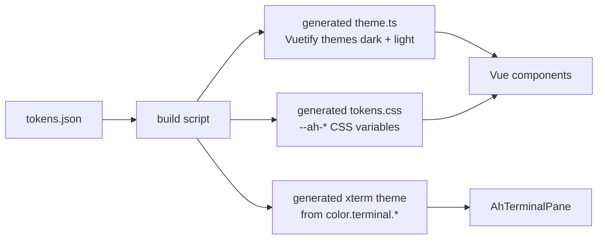

# Agent Hub Design System

Single source of truth for the visual language of Agent Hub: design tokens, motion rules and component specs.
Everything under `src/` that renders UI consumes these files; nothing here is hand-copied into components.

## File map

| Path | Purpose |
| --- | --- |
| `tokens.json` | All design tokens in W3C Design Tokens Community Group (DTCG) format |
| `Motion.md` | Motion principles, the allowed animate.css set, use-case table |
| `components/<Name>/index.d.ts` | Props, emits and slots contract for the component |
| `components/<Name>/README.md` | Anatomy, states, token usage, a11y rules, do/don't |
| `components/<Name>/preview.html` | Static dark-theme preview of every variant and state |
| `CHANGELOG.md` | Changes to tokens and specs |

Components: `AhButton`, `AhTabs` (+ `AhTab`), `AhStatusBadge`, `AhDialog`, `AhTerminalPane`.

## Token flow



1. `tokens.json` is edited by hand (and only here).
2. The build script resolves aliases, then emits:
   - `theme.ts` with `dark` and `light` Vuetify themes, using the mapping in `color.$extensions["dev.agenthub.vuetify"]`.
   - `tokens.css` with one CSS variable per token.
   - an xterm.js `ITheme` per theme from `color.terminal.*`.
3. Generated files are never edited by hand and carry a "generated" header.

## tokens.json structure

### Themes: per-token `dark` / `light` children

A **themed token** is a group whose only children are two tokens named `dark` and `light`:

```json
"canvas": {
  "dark":  { "$value": "{color.neutral.950}" },
  "light": { "$value": "{color.neutral.50}" }
}
```

- The token path used everywhere (docs, CSS variable, code) is the group path, e.g. `color.bg.canvas`. The theme suffix is never referenced directly.
- Non-themed tokens (palette, `space`, `radius`, `font`, `motion`, `z`) have a plain `$value`.
- `shadow.*` is themed as well (lighter shadows in the light theme).
- `$type` is declared on the top group and inherited (DTCG rule).

### Aliases

Values like `{color.neutral.950}` are DTCG aliases. The build script resolves them recursively; an unresolvable alias fails the build.
Palette steps (`color.neutral.*`, `color.accent.100` to `color.accent.900`, `color.red.*`, `color.green.*`, `color.amber.*`, `color.cyan.*`, `color.magenta.*`) are the only places with literal hex values, plus `color.terminal.selection` (needs alpha) and shadow colors.

### Value formats

| `$type` | Format | Example |
| --- | --- | --- |
| `color` | hex string, 6 or 8 digits (8 = alpha) | `#12151a`, `#3f7cf066` |
| `dimension` | string with `px` | `"4px"` |
| `duration` | string with `ms` | `"160ms"` |
| `cubicBezier` | array of 4 numbers | `[0.2, 0, 0, 1]` |
| `fontFamily` | array of names, first is preferred | `["Inter", "system-ui", ...]` |
| `fontWeight` / `number` | number | `600`, `1.4` |
| `shadow` | object `color, offsetX, offsetY, blur, spread` | |

Dimensions and durations use the string form for compatibility with common DTCG tooling.

### CSS variable naming

`--ah-` + token path with `.` replaced by `-`. Themed tokens drop the theme suffix.

| Token | CSS variable |
| --- | --- |
| `color.bg.canvas` | `--ah-color-bg-canvas` |
| `space.4` | `--ah-space-4` |
| `font.line-height.normal` | `--ah-font-line-height-normal` |
| `motion.easing.standard` | `--ah-motion-easing-standard` (emitted as `cubic-bezier(...)`) |
| `shadow.2` | `--ah-shadow-2` (emitted as `x y blur spread color`) |

`tokens.css` declares dark values on `:root, .v-theme--dark` and light values on `.v-theme--light`, so the variables follow the active Vuetify theme.

### Vuetify mapping

Defined in `color.$extensions["dev.agenthub.vuetify"]`; the build script reads it, so this table is informative only.

| Vuetify key | Token |
| --- | --- |
| `background` / `on-background` | `color.bg.canvas` / `color.fg.primary` |
| `surface` / `on-surface` | `color.bg.surface` / `color.fg.primary` |
| `surface-variant` / `on-surface-variant` | `color.bg.elevated` / `color.fg.primary` |
| `primary` / `on-primary` | `color.accent.default` / `color.fg.on-accent` |
| `secondary` / `on-secondary` | `color.secondary.default` / `color.fg.on-secondary` |
| `error` / `on-error` | `color.status.error` / `color.fg.on-status` |
| `warning` / `on-warning` | `color.status.waiting` / `color.fg.on-status` |
| `info` / `on-info` | `color.status.working` / `color.fg.on-status` |
| `success` / `on-success` | `color.status.success` / `color.fg.on-status` |

Note: Vuetify's default `surface-variant` is a dark tooltip fill with light text. Here it is the elevated surface with normal text, so tooltips use `color.bg.elevated` plus `shadow.2`.

## Rules

- **Tokens only** for color, spacing, radius, typography, shadow, motion and z-index. No raw hex, `rgb()`, px spacing or ms durations in components. Use the CSS variable or the Vuetify theme color.
- Fixed component metrics stated in a component spec (control heights, icon sizes, max widths, 1-2px borders) are allowed as literals; they are part of the component, not the token scale.
- The only raw values outside `tokens.json` are the fallback declarations at the top of each `preview.html`; they must equal the dark-theme values in `tokens.json`.
- **Dark theme is the default.** The light theme is fully supported and must pass the same contrast checks.
- New colors go into the palette first, then into a semantic token. Components reference semantic tokens (`color.bg.*`, `color.fg.*`, `color.status.*` ...), not palette steps.
- Motion follows `Motion.md`; animate.css classes outside the allowed list are forbidden.
- Every token change gets a `CHANGELOG.md` entry.

## Contrast (WCAG 2.2 AA)

Text pairs need at least 4.5:1, focus indicators and UI boundaries at least 3:1. Ratios computed from the resolved values in `tokens.json`.

| Foreground | Background | Dark | Light |
| --- | --- | --- | --- |
| `color.fg.primary` | `color.bg.canvas` | 16.14 | 15.72 |
| `color.fg.primary` | `color.bg.surface` | 14.76 | 16.73 |
| `color.fg.primary` | `color.bg.elevated` | 13.25 | 14.76 |
| `color.fg.primary` | `color.bg.hover` | 11.55 | 12.84 |
| `color.fg.primary` | `color.bg.selected` | 11.44 | 13.45 |
| `color.fg.muted` | `color.bg.canvas` | 7.24 | 5.74 |
| `color.fg.muted` | `color.bg.surface` | 6.62 | 6.11 |
| `color.fg.muted` | `color.bg.elevated` | 5.95 | 5.39 |
| `color.fg.on-accent` | `color.accent.default` | 6.72 | 5.43 |
| `color.fg.on-accent` | `color.accent.hover` | 9.18 | 7.51 |
| `color.fg.on-secondary` | `color.secondary.default` | 8.29 | 12.84 |
| `color.fg.on-danger` | `color.danger.default` | 6.82 | 5.65 |
| `color.fg.on-danger` | `color.danger.hover` | 9.07 | 7.43 |
| `color.fg.on-status` | `color.status.working` | 6.72 | 5.43 |
| `color.fg.on-status` | `color.status.waiting` | 10.00 | 5.76 |
| `color.fg.on-status` | `color.status.error` | 6.82 | 5.65 |
| `color.fg.on-status` | `color.status.success` | 8.65 | 5.39 |
| `color.status.working` | `color.bg.elevated` | 5.19 | 4.79 |
| `color.status.waiting` | `color.bg.elevated` | 7.72 | 5.08 |
| `color.status.error` | `color.bg.elevated` | 5.27 | 4.98 |
| `color.status.idle` | `color.bg.elevated` | 5.95 | 5.39 |
| `color.status.success` | `color.bg.elevated` | 6.68 | 4.76 |
| `color.border.focus` (3:1) | `color.bg.canvas` / `surface` / `elevated` | 6.31 / 5.77 / 5.19 | 5.10 / 5.43 / 4.79 |
| `color.terminal.fg` | `color.terminal.bg` | 14.04 | 16.73 |

Status colors also pass on `color.bg.surface` (higher ratios than on `elevated`).
`color.fg.disabled` is intentionally below 4.5:1 (disabled controls are exempt).
ANSI colors are not text-on-surface tokens; all exceed 4.5:1 on `color.terminal.bg` except dark `bright-black` (4.49), light `white` (4.07) and light `bright-white` (2.53), which follow terminal convention.
